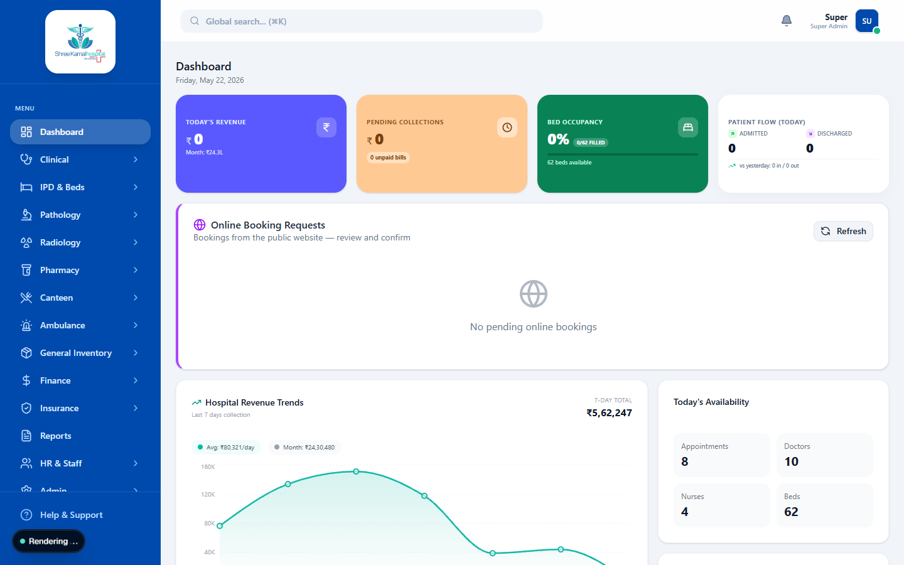

# Admin Dashboard

The Admin Dashboard is the central command center for the Hospital ERP. It provides the Hospital Administrator with high-level metrics, revenue tracking, and operational statistics across all departments.

## Overview

When logging in as an **Admin**, the default view is the Executive Dashboard. This interface consolidates data from Clinical, Pharmacy, Laboratory, and IPD modules into easy-to-read charts and key performance indicators (KPIs).

## Key Performance Indicators (KPIs)

At the top of the dashboard, you will find critical metrics that are updated in real-time based on the hospital's daily operations:

- **Total Revenue**: Consolidated income from OPD billing, Pharmacy sales, Lab tests, and IPD discharges.
- **Active Patients**: Number of patients currently admitted in the IPD (In-Patient Department).
- **OPD Consultations**: Total number of Out-Patient appointments for the day.
- **Bed Occupancy Rate**: A percentage showing how many beds are currently occupied versus the total capacity.

## Analytics & Charts

The dashboard includes detailed visual analytics:

1. **Revenue Trends**: A line chart showing revenue over the last 30 days, helping the administration track financial performance.
2. **Departmental Breakdown**: A pie chart or bar graph breaking down revenue and patient volume by department (e.g., Cardiology, Orthopedics, General Medicine).
3. **Recent Activities**: A real-time log of the latest activities, such as new patient admissions, major payments received, or stock alerts from the Pharmacy.

## Navigation

From the Admin Dashboard, use the left-hand sidebar to navigate to other administrative modules such as HR & Staff Management, Inventory Overview, and Hospital Settings.
