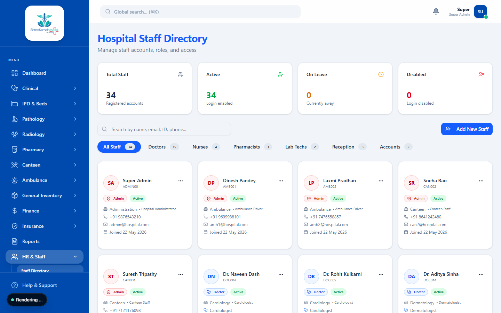

# HR & Staff Management

Managing the hospital's workforce is critical. The HR & Staff Management module allows the administration to oversee all doctors, nurses, pharmacists, and support staff.

## Staff Directory

The Staff Directory provides a comprehensive list of all employees in the hospital.

### Features

- **Search & Filter**: Quickly find staff members by their Employee ID, Name, Department, or Designation.
- **Role Assignment**: Assign roles (e.g., Doctor, Pharmacist, Lab Technician) to control their access levels within the ERP system.
- **Profile Management**: Update contact details, emergency contacts, and professional qualifications.
- **Payroll Integration**: View basic salary, attendance records, and generate monthly payroll slips.

## Adding New Staff

When a new employee joins the hospital:
1. Navigate to the **Staff** section and click **Add New Employee**.
2. Fill in their personal and professional details.
3. Assign a secure login email and an initial password.
4. Select their Role to grant them the appropriate permissions.
