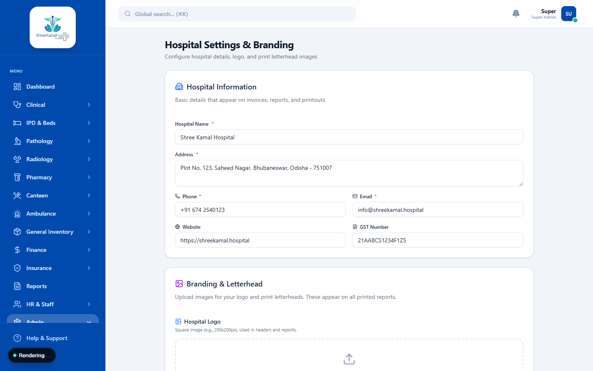

# Hospital Settings

The Hospital Settings module allows administrators to configure the core parameters of the ERP, ensuring the software aligns perfectly with the hospital's operational policies.

## Configuration Options

### 1. General Details
- **Hospital Name & Address**: Displayed on all printed invoices, prescriptions, and reports.
- **Contact Information**: Official phone numbers, email, and website.
- **Registration Numbers**: Important legal identifiers like GSTIN, Clinical Establishment Act Registration, and NABH Accreditation numbers.

### 2. IPD & Wards
Manage the physical infrastructure of the hospital.
- **Wards & Categories**: Define different types of wards (General, Private, ICU, HDU).
- **Bed Pricing**: Set the default per-day bed charges for each ward category.

### 3. Print Preferences
Customize the look and feel of printed documents.
- **Logo Upload**: Add the hospital's logo to letterheads.
- **Terms & Conditions**: Set default text for the footer of invoices and discharge summaries.
- **Paper Size**: Configure whether reports print on A4, A5, or thermal receipt paper.
