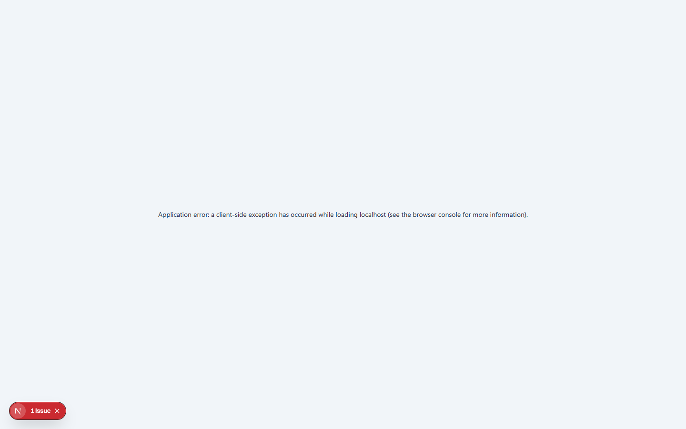

# Doctor Dashboard

The Doctor Portal is designed specifically for medical professionals to manage their appointments, view patient histories, and streamline their daily clinical workflow.

## Overview

When a doctor logs into the system (e.g., `doctor1@hospital.com`), they are greeted by their personalized dashboard. This dashboard focuses entirely on their own schedule and patients, stripping away administrative clutter.

## Today's Appointments

The central feature of the dashboard is the **Today's Appointments** list. 
- It displays a chronological list of all patients scheduled for the day.
- **Status Indicators**: Instantly see if a patient is 'Pending', 'Vitals Taken', 'In Progress', or 'Completed'.
- **Quick Actions**: With a single click, a doctor can jump straight into a patient's Electronic Medical Record (EMR) to begin the consultation.

## Clinical Metrics

To help manage their time, the dashboard provides quick metrics:
- **Total Appointments**: The overall load for the day.
- **Completed**: How many consultations have been finished.
- **Pending**: How many patients are currently waiting.
