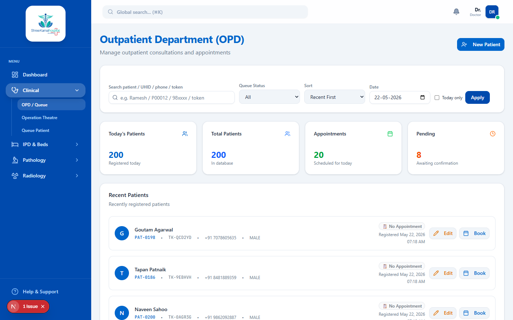

# OPD Queue & Vitals

The OPD (Out-Patient Department) Queue is the heartbeat of the clinical workflow. It bridges the gap between the nursing staff taking vitals and the doctor performing the consultation.

## The Queue Interface

### Workflow

1. **Patient Registration**: The Receptionist registers the patient and assigns them to a doctor.
2. **Vitals Station**: The nursing staff updates the patient's vitals (Blood Pressure, Heart Rate, SpO2, Temperature, Weight, Height) in the system. The patient's status changes to `Vitals Taken`.
3. **Doctor's Queue**: The doctor sees the patient in their OPD Queue, complete with the freshly recorded vitals.

### Starting a Consultation

From the OPD Queue, the doctor clicks **Begin Consultation**. This action transitions the patient's status to `In Progress` and opens the comprehensive EMR (Electronic Medical Record) interface. 

The doctor can immediately review the patient's chief complaints, past medical history, and the vitals just recorded by the nurse.
