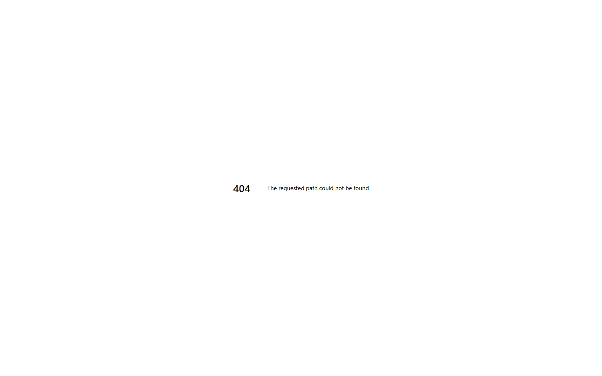

# Invoicing & Billing

The Finance module handles all monetary transactions, ensuring accurate billing and strict compliance with the Indian GST system.

## Centralized Billing

The Accountant uses the central billing dashboard to track all pending and completed transactions across the hospital.

### Features

- **Consolidated IPD Bills**: When a patient is discharged, the system automatically aggregates their room charges, surgery fees, pharmacy purchases, and lab tests into a single, comprehensive invoice.
- **Payment Gateways**: The system supports tracking payments made via Cash, Credit/Debit Card, UPI, or Bank Transfer.
- **Advance Tracking**: For IPD patients, the billing system tracks advance deposits and automatically deducts them from the final bill.

## GST Compliance

The Hospital ERP is fully compliant with Indian taxation laws. 
- The system automatically separates 0%, 5%, 12%, and 18% GST items on the invoice.
- It provides a dedicated GST module where accountants can generate **GSTR-1, GSTR-2B, and GSTR-3B** reports with a single click, ready for direct filing with the government portal.
