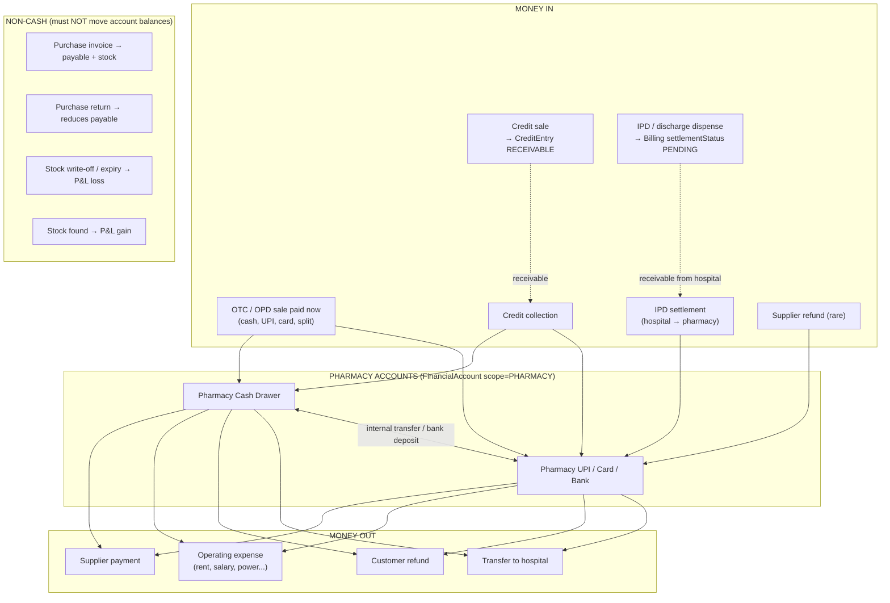

# PHARMACY FINANCE — MASTER IMPLEMENTATION PLAN

> **Audience:** an AI coding agent (Gemini) implementing this in the `hospital-erp` repo (Next.js 16 App Router, Prisma 6, PostgreSQL, shadcn/ui, Tailwind, recharts, date-fns, date-fns-tz, xlsx, sonner, zod).
> **Goal:** a new sidebar section **"Pharmacy Finance"** that works at the level of a real hospital pharmacy product: sales, money in, money out, receivables, payables, IPD settlement, cash register, inventory value, P&L and GST. When it is finished, the old finance pages under `Pharmacy` get removed (Phase 9).
> **Rule #1:** follow the phases **in order**. Do not start a phase until the previous phase passes its "Done when" checklist.

---

## 0. RULES FOR THE IMPLEMENTING AGENT (READ FIRST, OBEY ALWAYS)

1. **Read before you write.** Before you edit any file listed here, open it and read the surrounding code. Line numbers in this plan are approximate. Match on code, not line numbers.
2. **Never break existing exports.** `app/actions/pharmacy-finance.ts` is imported by `components/finance/accounts-client.tsx`, `components/pharmacy/finance/*` and others. Leave it untouched until Phase 9.
3. **New server actions go in a NEW folder named `app/actions/pharmacy-fin/`.** Do **NOT** create a folder named `app/actions/pharmacy-finance/`. It would clash with the existing file `pharmacy-finance.ts` and break module resolution.
4. **`"use server"` files may only export async functions.** Types and interfaces are fine (they get erased). **Constants, arrays, objects and plain helper functions must NOT be exported from a `"use server"` file.** Put them in `lib/pharmacy-finance/*.ts`, with **no** `"use server"` directive. Breaking this rule causes a runtime error.
5. **Every write that touches money goes inside `prisma.$transaction(async (tx) => { ... })`.** Use the interactive form, not the array form, whenever you need to read and then write.
6. **Balance decrements must be atomic and guarded.** Never do "read balance → check → update". Do this instead:
   ```ts
   const r = await tx.financialAccount.updateMany({
     where: { id: accountId, currentBalance: { gte: amount } },
     data: { currentBalance: { decrement: amount } },
   })
   if (r.count !== 1) throw new Error(`Insufficient balance in ${accountName}`)
   ```
7. **Every Transaction row you create MUST set:** `accountId, type ("INCOME" | "EXPENSE"), amount (> 0, rounded to 2dp), category, paymentMethod, scope, referenceId, description, accountGroupCode, billingType: "PHARMACY"`. Take `scope` from the **account's own `scope`**. Never hard-code it.
8. **Money rounding:** use `round2()` from `lib/pharmacy-finance/money.ts` on every amount **before** saving it. Compare money with a tolerance: `Math.abs(a - b) < 0.01`.
9. **Dates are IST.** Every "today", "this month" or date-range filter MUST use the helpers in `lib/pharmacy-finance/dates.ts`. Never call `new Date().setHours(0,0,0,0)`. The server may run in UTC.
10. **Auth:** every server action starts with
    `const auth = await requireAuthSafe(["SUPER_ADMIN", "PHARMACIST", "ACCOUNTANT"]); if (!auth.ok) return { success: false, message: auth.error }`.
    Read-only actions that return data (not `{success}`) use `requireAuth([...])`. Check `lib/auth-guard.ts` for the exact signatures.
11. **Return shape for mutations:** `Promise<{ success: boolean; message: string; data?: T }>`. Never throw to the client. Wrap the body in `try/catch` and use `getErrorMessage(error)` from `lib/action-result`.
12. **Audit:** after every successful mutation, call `writeAuditLog({ userId, action, module: "PharmacyFinance", recordId, changes })`.
13. **Revalidate:** after a mutation, call `revalidatePath("/dashboard/pharmacy-finance", "layout")`.
14. **No `any`** except where Prisma `tx` typing forces it. In that case use the existing `TxClient` type from `lib/inventory-service.ts` if it is exported. Otherwise use `Prisma.TransactionClient`.
15. **After each phase:** run
    `npx tsc --noEmit 2>&1 | Select-String "pharmacy-fin|pharmacy-finance|lib/pharmacy-finance|stock-adjustment|sales-returns|purchase.ts|supplier-profile|credit.ts|lib/actions.ts|dashboard-sidebar|permissions"`.
    The output must be **empty**. There are pre-existing errors in unrelated files. Ignore those, and do not "fix" them.
16. **Prisma:** after any schema change, run `npx prisma db push` and then `npx prisma generate`. **Stop the dev server first** (Windows locks the Prisma engine DLL).
17. **Destructive data scripts** (anything that deletes or rewrites existing rows) must default to `--dry-run` and need explicit user approval before you run them with `--apply`.
18. **UI:** use only the existing `components/ui/*` (card, table, tabs, dialog, select, popover, calendar, badge, button, input, label, textarea, sheet, tooltip, skeleton, alert, alert-dialog, dropdown-menu, scroll-area, checkbox, switch, separator, command) plus `recharts`. Brand primary color is `#0066CC` (used in existing pharmacy pages). Use `sonner` `toast` for feedback.

---

## 1. THE MONEY MODEL (WHAT THE SOFTWARE MUST REPRESENT)

### 1.1 The three books
| Book | Answers | Source of truth |
|---|---|---|
| **Cash book** | "How much money is in each drawer or bank account, and why did it change?" | `Transaction` rows (scope `PHARMACY`) + `FinancialAccount.currentBalance` |
| **Profit & Loss** | "Did the pharmacy make money?" | **Source documents only:** `Billing`/`BillingItem` (sales, cost), `SalesReturn`, `StockAdjustmentItem`, expense `Transaction`s. **NEVER** sum `Transaction` INCOME rows for revenue (that double-counts IPD settlements and transfers). |
| **Party ledgers** | "Who owes us, and whom do we owe?" | Receivables: `CreditEntry` (type RECEIVABLE) + pending IPD bills. Payables: `PurchaseInvoice`, `SupplierPayment`, `PurchaseReturn`, `Supplier.openingBalance` |

### 1.2 Money flow


### 1.3 Canonical Transaction categories (pharmacy scope)
Define these in `lib/pharmacy-finance/constants.ts` and use **only** these for new rows:

| Category | type | accountGroupCode | Counts as | Created by |
|---|---|---|---|---|
| `PHARMACY_SALE` | INCOME | 4150 | cash-in (operating) | POS sale (exists) |
| `CREDIT_COLLECTION` | INCOME | 1130 | cash-in (operating) | receivables collect (Phase 5) |
| `IPD_SETTLEMENT` | INCOME | 1130 | cash-in (operating) | settleBillInTx (exists) |
| `SUPPLIER_REFUND` | INCOME | 2110 | cash-in (operating) | payables (Phase 5) |
| `SALES_REFUND` | EXPENSE | 6100 | cash-out (operating) | sales-returns (exists, fixed Phase 1) |
| `SUPPLIER_PAYMENT` | EXPENSE | 2110 | cash-out (operating) | supplier-profile (exists, fixed Phase 1) |
| `PHARMACY_EXPENSE` | EXPENSE | per head (§6.8) | cash-out (operating) + P&L expense | expenses (Phase 6) |
| `INTERNAL_TRANSFER_OUT` / `INTERNAL_TRANSFER_IN` | EXPENSE / INCOME | 1110 or 1120 | transfer (excluded from in/out totals) | accounts (Phase 6) |
| `INTER_DEPT_TRANSFER_OUT` / `INTER_DEPT_TRANSFER_IN` | EXPENSE / INCOME | (existing resolver) | transfer (excluded from operating totals, shown separately) | existing crossDepartmentTransfer |
| `CASH_VARIANCE` | INCOME (excess) / EXPENSE (short) | 4240 / 5270 | adjustment | day close (Phase 7) |
| `OPENING_BALANCE` | INCOME | 1110 | adjustment | account create (only if openingBalance currently posts a row — check) |

Legacy categories that may already exist in the DB: `STOCK_WRITE_OFF`, `STOCK_ADJUSTMENT_GAIN`, `PURCHASE_RETURN`, `Credit Payment Received`, `Credit Payment Made`. Reports must recognize them (map them in `constants.ts` → `LEGACY_CATEGORY_MAP`). Phase 1 stops new rows from being created with the first three.

**Signed amount rule (one function, used everywhere):**
```ts
// lib/pharmacy-finance/money.ts
export const signed = (t: { type: string; amount: number }) => (t.type === "INCOME" ? t.amount : -t.amount)
```
Before you write this, grep `type: "` inside `tx.transaction.create` / `prisma.transaction.create` across the repo. Confirm that only `INCOME` and `EXPENSE` are used. If any other value exists (e.g. `TRANSFER`), handle it explicitly and note it in this file.

---

## 2. EXISTING BUGS — FIX FIRST (PHASE 1)

These bugs corrupt the numbers the new module will show. Fix them before you build any UI.

### B1. Stock adjustments move cash (WRONG)
**File:** `app/actions/stock-adjustment.ts` (around lines 137–183).
**Problem:** a write-off decrements the *Pharmacy Cash Drawer*, and found stock increments it. No cash actually moved.
**Fix:** delete the whole `if (Math.abs(totalValueChange) > 0) { ... }` block that creates the Transaction and updates `financialAccount`. Keep the `StockAdjustment` / `StockAdjustmentItem` creation (it already snapshots `unitCost`). Reports will read write-offs straight from `StockAdjustmentItem` (Phase 8).

### B2. Purchase return adds cash (WRONG)
**File:** `app/actions/purchase.ts` → `createPurchaseReturn` (around lines 414–435).
**Problem:** it creates `INCOME / PURCHASE_RETURN` on the cash drawer. In practice the supplier issues a credit note (the payable goes down) and no cash comes back.
**Fix:** delete the ledger block. The payables calculation (Phase 5) subtracts `PurchaseReturn.totalAmount` from what is owed. If the supplier really pays back cash, the user records a `SUPPLIER_REFUND` from the Payables page.

### B3. Customer refund always hits the cash drawer and silently skips when there is none
**File:** `app/actions/sales-returns.ts` → the approve/process function (around lines 144–173).
**Fix:** inside the existing transaction, load `originalBill` (with `settlementStatus`, `ipdAdmissionId`, `paymentMethod`, `netAmount`, `balanceAmount`) and the open `CreditEntry` where `referenceId = originalBill.id`. Then branch:

| Original bill situation | What to do | Cash moves? |
|---|---|---|
| `settlementStatus === "PENDING"` (IPD, not settled yet) | Lower the bill: `netAmount -= refund`, `balanceAmount -= refund` (floor at 0). This automatically shrinks the IPD settlement and the IPD final bill. | No |
| `settlementStatus === "SETTLED"` | **Block** with this message: "This IPD bill is already settled with the hospital. Reverse it via Cross-Department Transfer." | — |
| An open `CreditEntry` exists with `balanceAmount > 0` | Reduce `CreditEntry.totalAmount` and `balanceAmount` by `min(refund, balance)`. Pay any remainder in cash (next row). If the balance reaches 0, set the status to `SETTLED`. | Only the remainder |
| Otherwise (paid sale) | `accountId = resolveFinancialAccount(tx, refundMethod ?? (bill.paymentMethod === "SPLIT" ? "CASH" : bill.paymentMethod ?? "CASH"), "PHARMACY")`, then do a **guarded decrement** (Rule 6) and create `EXPENSE / SALES_REFUND / 6100`. | Yes |

If the function has no `refundMethod` parameter, add an optional `refundMethod?: string` and default to the rule above. Never skip silently. If no account can be resolved, throw.

### B4. Credit collections are posted to the HOSPITAL scope
**File:** `app/actions/credit.ts` → `recordCreditPayment` (around lines 208–300).
**Fix:**
- Convert it to the interactive `$transaction`.
- Load the account and set `scope: account.scope` on the Transaction.
- When the account scope is PHARMACY: use `category: "CREDIT_COLLECTION"` for receivables, `accountGroupCode: "1130"`, `billingType: "PHARMACY"`.
- Allow role `PHARMACIST`, but **only** when the selected account's scope is `PHARMACY` (check this after loading the account).
- Payables (`type === "PAYABLE"`) must use a guarded decrement.

### B5. Supplier payment has no overpay check, no balance check, and the account is optional
**File:** `app/actions/supplier-profile.ts` → `recordSupplierPayment` (around lines 279–369).
**Fix, inside the transaction:**
1. `accountId` is **required**. Load the account and require `account.scope === "PHARMACY"` and `isActive`.
2. If `invoiceId` is set: `due = grandTotal − amountPaid − Σ(PurchaseReturn.totalAmount where invoiceId)`. Reject when `amount > due + 0.01`, with the message `Amount exceeds invoice due of ₹X`.
3. Guarded decrement on the account (Rule 6).
4. Create the SupplierPayment **first** and keep its `id`. Then create the Transaction with `referenceId: payment.id`, `accountGroupCode: "2110"`, `scope: account.scope`, and a description that includes the supplier name and invoice number.
5. Update the invoice `amountPaid`/`status` as it does today, but compute status against `due` (net of returns).
Check every UI caller (`grep recordSupplierPayment`). They must now send `accountId`. Make the account select **required** in those forms.

### B6. POS sale Transactions are missing tags
**File:** `lib/actions.ts` around lines 1654–1696 (both split and single branches).
**Fix:** add `accountGroupCode: "4150"` and `billingType: "PHARMACY"` to both `tx.transaction.create` calls. Change nothing else.

### B7. Cross-department transfer has a balance race
**File:** `app/actions/pharmacy-finance.ts` → `crossDepartmentTransfer`.
**Fix:** convert it to an interactive `$transaction` with a guarded decrement on `fromAccountId` (Rule 6). Keep the same messages. Also set `referenceId` on both rows to one shared id (`crypto.randomUUID()`) so the pair can be linked. (This is the **only** edit allowed in `pharmacy-finance.ts` before Phase 9.)

### B8. One-time correction script for historical bad rows (B1, B2)
Create `scripts/pharmacy-finance/fix-noncash-ledger.ts` (run with `npx tsx`).
- It finds `Transaction` rows where `scope = "PHARMACY"` and `category IN ("STOCK_WRITE_OFF","STOCK_ADJUSTMENT_GAIN","PURCHASE_RETURN")`.
- `--dry-run` (the default) prints a count, the total per category, and the net balance change per account.
- `--apply` does this in **one** `$transaction`: for each row, create a reversing Transaction (opposite `type`, same amount, `category: "NONCASH_REVERSAL"`, `referenceId: original.id`, description `Reversal of non-cash entry <id>`) and apply the opposite balance change to the account.
- It is idempotent: skip rows that already have a `NONCASH_REVERSAL` whose `referenceId` equals their id.
- **Do not run `--apply` without user confirmation.** Reports exclude `STOCK_WRITE_OFF`, `STOCK_ADJUSTMENT_GAIN`, `PURCHASE_RETURN` and `NONCASH_REVERSAL` from cash in/out totals. They still show in the account ledger, so the running balance stays correct.

**Phase 1 is done when:** tsc is clean for the touched files; a stock write-off no longer changes any account balance; a purchase return no longer changes any account balance; a refund on a pending IPD bill lowers that bill's netAmount; a supplier payment above the invoice due is rejected; a supplier payment above the account balance is rejected.

---

## 3. SCHEMA CHANGES (PHASE 2)

Keep changes minimal. Edit `prisma/schema.prisma`.

### 3.1 Cost snapshot on sale lines (needed for real profit)
```prisma
model BillingItem {
  // ...existing fields...
  unitCost   Float?   // purchase cost per unit at time of sale (null = unknown/legacy)
  costAmount Float?   // quantity × unitCost (sum of FEFO allocations), rounded 2dp
}
```

### 3.2 Daily cash register close
```prisma
model PharmacyDayClose {
  id                 String   @id @default(cuid())
  businessDate       String   // "YYYY-MM-DD" in IST — string on purpose (no TZ bugs)
  accountId          String   // the cash drawer being closed
  openingCash        Float
  cashIn             Float    // Σ INCOME on that account that day (excl. transfers)
  cashOut            Float    // Σ EXPENSE on that account that day (excl. transfers)
  transfersIn        Float
  transfersOut       Float
  expectedCash       Float
  countedCash        Float
  variance           Float    // counted − expected
  denominations      Json?    // { "500": 4, "200": 10, ... }
  notes              String?
  varianceTxnId      String?  // Transaction id created for the variance, if any
  closedBy           String
  closedAt           DateTime @default(now())
  account            FinancialAccount @relation(fields: [accountId], references: [id])

  @@unique([businessDate, accountId])
  @@index([businessDate])
  @@map("pharmacy_day_closes")
}
```
Add `dayCloses PharmacyDayClose[]` to `FinancialAccount`.

No other schema changes. Expenses, transfers and refunds use `Transaction`. Expense heads are constants.

### 3.3 Capture cost at every point where pharmacy stock is sold
Find every place that creates a `BillingItem` for a `Billing` of `type: "PHARMACY"`:
```
grep -rn "billingItem.create\|items: { create\|billingItem.createMany" lib app
```
These are known locations. Verify each one, and also look for others (IPD dispense, OT dispense):
- `lib/actions.ts` around line 1535 (POS). The batch is `item.batchId`. Load the batch's `purchasePrice` (it is already fetched just below as `batch`; move that fetch above the create). `unitCost = batch.purchasePrice`, `costAmount = round2(item.quantity * unitCost)`.
- `lib/actions/pharmacy.ts` (discharge-medicine dispense, which uses `deductFEFO`). `costAmount = round2(Σ alloc.units × alloc.purchasePrice)`. If `deductFEFO` does not return `purchasePrice` per allocation, extend its return type in `lib/inventory-service.ts` to include it (select it in the same query). `unitCost = round4(costAmount / qty)`.
- Every IPD prescription dispense and OT dispense that creates PHARMACY billing items: apply the same rule.

**Units:** `InventoryBatch.purchasePrice` is **per unit** and `InventoryBatch.quantity` is in **units** (confirmed in `addToInventory`, `lib/inventory-service.ts` lines 60–105). `BillingItem.quantity` is in units for POS. Confirm this for each other call site before multiplying.

### 3.4 Backfill script for old sales
`scripts/pharmacy-finance/backfill-cost.ts` (default `--dry-run`):
- For `BillingItem` where `costAmount IS NULL` and the billing type is PHARMACY and `referenceId` matches an `InventoryBatch.id`: `unitCost = batch.purchasePrice`, `costAmount = round2(qty × unitCost)`.
- For discharge medicines with `batchAllocations` JSON linked through `billingId`: sum the allocations.
- Leave everything else NULL. Print counts: fixed, unknown.
- Only updates NULL fields, so it is safe to re-run. Ask the user before running `--apply`.

**Phase 2 is done when:** `db push` and `generate` succeed; a new POS sale stores `costAmount`; a discharge dispense stores `costAmount`; tsc is clean.

---

## 4. SHARED LIBRARY (PHASE 3a)

Create `lib/pharmacy-finance/` (**no** `"use server"` in these files).

### 4.1 `money.ts`
```ts
export const round2 = (n: number) => Math.round((n + Number.EPSILON) * 100) / 100
export const round4 = (n: number) => Math.round((n + Number.EPSILON) * 10000) / 10000
export const sum = (xs: number[]) => round2(xs.reduce((a, b) => a + b, 0))
export const signed = (t: { type: string; amount: number }) => (t.type === "INCOME" ? t.amount : -t.amount)
export const inr = (n: number | null | undefined, frac = 0) =>
  new Intl.NumberFormat("en-IN", { style: "currency", currency: "INR", maximumFractionDigits: frac }).format(n ?? 0)
export const pct = (num: number, den: number) => (den === 0 ? 0 : round2((num / den) * 100))
```

### 4.2 `dates.ts` (IST, using `date-fns-tz`)
```ts
import { fromZonedTime, toZonedTime, formatInTimeZone } from "date-fns-tz"
export const TZ = "Asia/Kolkata"
export type DateRange = { from: Date; to: Date; fromStr: string; toStr: string } // `to` is EXCLUSIVE (start of the day after toStr)
export function todayStr(): string                       // "YYYY-MM-DD" in IST
export function istDayStart(dateStr: string): Date       // fromZonedTime(`${dateStr}T00:00:00`, TZ)
export function rangeFromStrings(fromStr: string, toStr: string): DateRange  // to = istDayStart(toStr + 1 day)
export function presetRange(p: "today"|"yesterday"|"7d"|"30d"|"mtd"|"lastMonth"|"qtd"|"fytd"): DateRange  // Indian FY starts 1 April
export function parseRangeParams(sp: Record<string, string | string[] | undefined>, fallback = "mtd"): DateRange // reads ?from=&to=&preset=
export function fmtIST(d: Date | string, pattern = "dd MMM yyyy, hh:mm a"): string
```
All Prisma date filters use `{ gte: range.from, lt: range.to }`. Never use `lte` with an end-of-day time.

**Raw SQL day grouping** (Postgres; the tables are mapped, e.g. `billings`, and the columns are camelCase, so quote them):
```sql
SELECT (("billDate" AT TIME ZONE 'UTC') AT TIME ZONE 'Asia/Kolkata')::date AS day, ...
FROM billings WHERE type = 'PHARMACY' AND "billDate" >= $1 AND "billDate" < $2 GROUP BY 1 ORDER BY 1
```
Use `prisma.$queryRaw` with tagged-template parameters (never string concatenation). Cast numeric results with `Number(...)`, because Postgres returns `bigint`/`numeric` that do not JSON-serialize.

### 4.3 `constants.ts`
- `PH_CATEGORIES` (§1.3), `TRANSFER_CATEGORIES`, `NONCASH_LEGACY_CATEGORIES`, `LEGACY_CATEGORY_MAP`.
- `EXPENSE_HEADS` (§6.8).
- `SALE_CHANNELS = ["OTC", "OPD", "IPD", "EMERGENCY", "CASUALTY", "CREDIT"] as const`.
- `VALID_SALE_STATUSES = ["PAID", "PARTIALLY_PAID", "PENDING", "PENDING_GOVERNMENT_PAYMENT"]` (excludes DRAFT, CANCELLED and REFUNDED. A REFUNDED bill is a full return, and returns are handled through SalesReturn, so verify with the sales-returns code whether a full return sets REFUNDED *and* creates a SalesReturn. If it does both, exclude REFUNDED here to avoid double subtraction. Document what you find).
- `AGING_BUCKETS = [{label:"0–30",min:0,max:30},{label:"31–60",min:31,max:60},{label:"61–90",min:61,max:90},{label:"90+",min:91,max:Infinity}]`.

### 4.4 `scope.ts` (Prisma `where` builders, the single definition of "what counts")
```ts
export function pharmacySalesWhere(r: DateRange): Prisma.BillingWhereInput  // type PHARMACY, status in VALID_SALE_STATUSES, billDate in range
export function saleChannel(b: { ipdAdmissionId: string|null; emergencyVisitId: string|null; casualtyVisitId: string|null; appointmentId: string|null; isCredit: boolean }): SaleChannel
// precedence: IPD > EMERGENCY > CASUALTY > CREDIT > OPD > OTC
export function pharmacyAccountsWhere(): Prisma.FinancialAccountWhereInput // { scope: "PHARMACY" }
export function cashMovementWhere(r: DateRange, accountIds?: string[]): Prisma.TransactionWhereInput // scope PHARMACY, date in range, category NOT IN NONCASH_LEGACY_CATEGORIES + NONCASH_REVERSAL
```
`isCredit` = a `CreditEntry` exists with `referenceType: "BILLING"` and `referenceId = bill.id`. Load these in one query (`findMany where referenceId in ids`) and build a Set. **No N+1 queries.**

### 4.5 `export.ts` (client-safe)
`exportRows(filename: string, rows: Record<string, unknown>[], format: "csv"|"xlsx")` uses the `xlsx` package (`utils.json_to_sheet`, `writeFile`). Import it dynamically inside the function so it stays out of the initial bundle.

---

## 5. NAVIGATION, PERMISSIONS, LAYOUT (PHASE 3b)

### 5.1 Permissions — `lib/permissions.ts`
Add a module right after `PHARMACY`:
```ts
{ id: "PHARMACY_FINANCE", label: "Pharmacy Finance", subModules: [
  { id: "PHARMACY_FINANCE_VIEW", label: "View reports" },
  { id: "PHARMACY_FINANCE_MANAGE", label: "Record payments / expenses / transfers" },
  { id: "PHARMACY_FINANCE_DAYCLOSE", label: "Day close" },
]}
```
Sub-items in the sidebar will **not** carry `permissionId` (so anyone with the parent can see them). The `MANAGE` and `DAYCLOSE` permissions are enforced in server actions: allow `SUPER_ADMIN` and `ACCOUNTANT` always; allow other roles only if `session.permissions` includes the id. First check how `requireAuthSafe` exposes permissions (read `lib/auth-guard.ts`). If it does not expose them, fall back to role checks: `["SUPER_ADMIN","ACCOUNTANT","PHARMACIST"]`.

> ⚠ Existing non-admin users with a custom permission list will **not** see the new section until an admin grants `PHARMACY_FINANCE` in their role template. Mention this in the final summary to the user.

### 5.2 Sidebar — `components/layout/dashboard-sidebar.tsx`
Insert a new group **immediately after the `Pharmacy` group**. `BadgeIndianRupee` is already imported.
```ts
{
  label: "Pharmacy Finance",
  href: "/dashboard/pharmacy-finance",
  icon: BadgeIndianRupee,
  permissionId: "PHARMACY_FINANCE",
  roles: ["SUPER_ADMIN", "PHARMACIST", "ACCOUNTANT"],
  subItems: [
    { label: "Overview",            href: "/dashboard/pharmacy-finance" },
    { label: "Sales Register",      href: "/dashboard/pharmacy-finance/sales" },
    { label: "Returns & Refunds",   href: "/dashboard/pharmacy-finance/returns" },
    { label: "Receivables",         href: "/dashboard/pharmacy-finance/receivables" },
    { label: "IPD Settlements",     href: "/dashboard/pharmacy-finance/ipd-settlements" },
    { label: "Payables",            href: "/dashboard/pharmacy-finance/payables" },
    { label: "Purchase Register",   href: "/dashboard/pharmacy-finance/purchases" },
    { label: "Expenses",            href: "/dashboard/pharmacy-finance/expenses" },
    { label: "Cash & Bank",         href: "/dashboard/pharmacy-finance/accounts" },
    { label: "Day Close",           href: "/dashboard/pharmacy-finance/day-close" },
    { label: "Inventory Value",     href: "/dashboard/pharmacy-finance/inventory-value" },
    { label: "Profit & Loss",       href: "/dashboard/pharmacy-finance/pnl" },
    { label: "GST Summary",         href: "/dashboard/pharmacy-finance/gst" },
  ],
},
```
Check how the sidebar decides the active item. If `/dashboard/pharmacy-finance` is a prefix match, make sure "Overview" is highlighted only on an exact match (the existing "Dashboard" sub-item of Pharmacy has the same issue, so copy whatever it does). Also confirm that `/dashboard/pharmacy` does **not** prefix-match `/dashboard/pharmacy-finance`. If it uses `startsWith`, change the check to `pathname === href || pathname.startsWith(href + "/")`.

### 5.3 Route layout
`app/dashboard/pharmacy-finance/layout.tsx`: a server component that only renders `{children}` inside `<div className="space-y-6 p-1">`. Add `loading.tsx` next to it with skeleton cards.

### 5.4 Shared UI components — `components/pharmacy-finance/`
| Component | Purpose |
|---|---|
| `page-header.tsx` | Title (h1), subtitle, right-side action slot |
| `date-range-filter.tsx` | Client. Preset buttons (Today, Yesterday, 7D, 30D, MTD, Last month, QTD, FYTD) + custom From/To with `Popover`+`Calendar`. Writes `?preset=` or `?from=&to=` with `router.replace` (no scroll). Used on every report page. |
| `kpi-card.tsx` | label, value (₹), optional delta vs previous period (green/red arrow), icon, optional href |
| `money.tsx` | `<Money value={n} />`: right-aligned, tabular-nums, red when negative |
| `data-table.tsx` | Thin wrapper over `components/ui/table` with a sticky header, a footer totals row, an empty state and pagination controls (server-side `?page=`) |
| `export-button.tsx` | Calls a server action that returns rows for the current filters, then `exportRows(...)` |
| `status-badge.tsx` | Consistent colors: PAID green, PARTIAL amber, PENDING/UNPAID red-ish, SETTLED teal, OVERDUE red |
| `account-select.tsx` | Select of active PHARMACY accounts showing the live balance; prop `requireBalance?: number` disables accounts with insufficient balance |

Pagination: 50 rows per page. Totals always come from a separate `aggregate` over the **full filter**, not from the current page.

---

## 6. PAGES & SERVER ACTIONS (PHASES 4–8)

The pattern for every page is:
```
app/dashboard/pharmacy-finance/<page>/page.tsx      ← async server component; reads searchParams (await it — Next 16 passes a Promise), calls action(s), renders client
components/pharmacy-finance/<page>-client.tsx       ← "use client" UI
app/actions/pharmacy-fin/<page>.ts                  ← "use server" queries + mutations
```
In Next.js 16, `searchParams` and `params` are **Promises**: `export default async function Page({ searchParams }: { searchParams: Promise<Record<string, string | string[] | undefined>> }) { const sp = await searchParams }`.

All server action return values must be **plain serializable** values: convert Dates to ISO strings and Prisma Decimals/bigints to `Number`.

### 6.1 Overview — `/dashboard/pharmacy-finance` (Phase 4)
**Action:** `getPharmacyFinanceOverview(range: {fromStr,toStr})` in `app/actions/pharmacy-fin/overview.ts`.

**KPI cards (row 1, period-based, each with a delta vs the previous equal-length period):**
| KPI | Formula |
|---|---|
| Gross Sales | Σ `Billing.netAmount` where `pharmacySalesWhere(range)` |
| Returns | Σ `SalesReturn.refundAmount` where `refundStatus = "APPROVED"` and `date` in range |
| Net Sales | Gross Sales − Returns |
| Gross Profit | Net Sales (ex-GST) − COGS. Ex-GST: `Σ(netAmount − taxAmount)` for sales, minus returns scaled by each original bill's `(netAmount − taxAmount)/netAmount`. COGS = Σ `BillingItem.costAmount` for those bills. Show a "Margin %" sub-label. If any sale line in range has `costAmount = null`, show a small ⚠ tooltip: "N lines without cost — profit understated/overstated". |
| Cash Collected | Σ signed INCOME in `cashMovementWhere(range)` excluding `TRANSFER_CATEGORIES` |
| Cash Paid Out | Σ EXPENSE in `cashMovementWhere(range)` excluding `TRANSFER_CATEGORIES` |

**Position cards (row 2, as of now, not period-based):**
| Card | Formula | Links to |
|---|---|---|
| Cash & Bank Balance | Σ `FinancialAccount.currentBalance` (scope PHARMACY, active) | /accounts |
| Receivable — Customers | Σ `CreditEntry.balanceAmount` where type RECEIVABLE, status ≠ SETTLED, and `referenceId` ∈ PHARMACY bills | /receivables |
| Receivable — Hospital (IPD) | Σ `Billing.netAmount` where type PHARMACY and `settlementStatus = "PENDING"` | /ipd-settlements |
| Payable — Suppliers | Σ over suppliers of the outstanding amount (§6.6) | /payables |
| Stock Value (cost) | `getClosingStockTotal()` from `lib/inventory-valuation.ts` | /inventory-value |
| Expiring ≤ 90 days (cost) | Σ qty×purchasePrice for active batches with qty > 0 and `expiryDate < now+90d` | /inventory-value |

**Charts:**
1. **Daily Sales vs Cash Collected** (recharts `ComposedChart`): bars = net sales per IST day (raw SQL, §4.2), line = cash collected per day. Fill missing days with 0.
2. **Sales by Channel** (`PieChart`): OTC / OPD / IPD / EMERGENCY / CASUALTY / CREDIT.
3. **Payment Mix** (`BarChart`): CASH / UPI / CARD / CREDIT / IPD-pending. A SPLIT bill must be broken into its `splitCashAmount`, `splitUpiAmount`, `splitCardAmount` parts.
4. **Top 10 Medicines by Revenue** and **Top 10 by Profit** (tables). Group `BillingItem` by `referenceId` → batch → medicine. Use one raw SQL with joins (`billing_items` → `billings` → `inventory_batches` → `medicines`). Items with no batch reference are grouped under their `description`.

**Alerts panel:** pending IPD settlements count; supplier invoices overdue (due date passed); customer credit > 30 days; yesterday not day-closed; ledger mismatch on any account (§6.9 integrity check); lines without cost in range.

### 6.2 Sales Register — `/sales` (Phase 4)
**Action:** `getSalesRegister({ range, channel?, paymentMethod?, status?, search?, page })` + `exportSalesRegister(sameFilters)` (cap 20,000 rows).
**Filters:** date range, channel, payment method (CASH, UPI, CARD, SPLIT, CREDIT, INSURANCE), status, search (bill number, patient name, patient ID, phone).
**Columns:** Date/time (IST) · Bill No · Patient / Customer · Channel · Items (count) · Gross · Discount · GST · Net · Cost · Profit · Margin% · Payment · Status · Settlement (IPD only).
**Footer totals** (whole filter): Gross, Discount, GST, Net, Cost, Profit.
**Row click** opens a side `Sheet` with the bill's items (description, qty, rate, GST, total, cost), its payments/split, linked returns, and a "Print" link to the existing bill print route (find it with `grep "print" app/dashboard/pharmacy/bills`).
**Patient name:** `pharmacyCustomer.name` ?? `patient.name` ?? "Walk-in".

### 6.3 Returns & Refunds — `/returns` (Phase 4)
**Action:** `getReturnsRegister({ range, status?, page })`.
**Columns:** Date · Return No · Original Bill · Patient · Items · Refund Amount · Refund Mode (cash/credit-adjust/IPD-adjust; take it from the linked Transaction or bill change) · Status · Approved By.
**KPIs:** total returns, return rate % (returns ÷ gross sales), pending approval count and value.
This page is **read-only**. Link to the existing approval screen `/dashboard/pharmacy/sales-returns` for actions. (Approval logic stays where it is, fixed in B3.)

### 6.4 Receivables — `/receivables` (Phase 5)
**Action:** `getPharmacyReceivables({ status?: "OPEN"|"PARTIAL"|"SETTLED"|"ALL", search?, page })`. It returns credit entries whose `referenceType = "BILLING"` and whose `referenceId` is a PHARMACY billing (filter in DB: first get the PHARMACY bill ids via the `referenceId in` subquery, or a raw SQL join).
**Columns:** Party · Bill No · Bill Date · Total · Paid · Balance · Age (days since bill date) · Aging bucket · Status · [Collect].
**Header:** aging summary across `AGING_BUCKETS` and the total outstanding.
**Collect dialog:** amount (max = balance), payment method (CASH/UPI/CARD/BANK_TRANSFER), destination account (`account-select`, PHARMACY only, preselected with `resolveFinancialAccount` logic for the chosen method), reference, notes. Submitting calls the **fixed** `recordCreditPayment` from `app/actions/credit.ts` (B4). Do not duplicate it. On success, show a toast and `router.refresh()`.
**Party view:** clicking a party name filters by `partyId` and shows that party's statement (all entries + payments in date order with a running balance).

### 6.5 IPD Settlements — `/ipd-settlements` (Phase 5)
Re-use the existing actions `getIPDSettlements`, `settleIPDMedicineBill` and `bulkSettleIPDMedicineBills` from `app/actions/pharmacy-finance.ts` (import them; do not copy them).
Build a new client `components/pharmacy-finance/ipd-settlements-client.tsx` with:
- Tabs: Pending / Settled / All.
- Group by admission: patient name, IPD no, admission and discharge status, bill count, total. Expand a group to see its bills.
- "Settle" per bill and "Settle all for this admission". Show an `AlertDialog` confirm that states the amount, the hospital account that will be debited and its current balance (load hospital accounts via `getCrossDepartmentAccounts`).
- KPI: pending count, pending amount, settled this month, average days to settle.
- A warning badge on pending bills whose admission is **not discharged yet** ("patient still admitted — bill may still change"). Settling them is still allowed.

### 6.6 Payables — `/payables` (Phase 5)
**Action:** `getSupplierPayables({ search?, onlyOutstanding?: boolean })` and `getSupplierStatement(supplierId, range?)`.

**Outstanding per supplier (the single formula, used everywhere):**
```
outstanding = Supplier.openingBalance
            + Σ PurchaseInvoice.grandTotal
            − Σ SupplierPayment.amount
            − Σ PurchaseReturn.totalAmount
            − Σ Transaction.amount where category = "SUPPLIER_REFUND" and referenceId = supplierId   (refund given back to us reduces what they owe us → ADD instead; see note)
```
> Note on SUPPLIER_REFUND: a refund happens when we **over-paid** (outstanding < 0) and the supplier returns cash. It moves outstanding back toward 0, so it **adds** to outstanding. Write it as `+ Σ SUPPLIER_REFUND`. Add a unit-style assertion comment explaining this.

Use `groupBy` per table (`purchaseInvoice.groupBy({ by: ["supplierId"], _sum: { grandTotal: true } })`, etc.) and merge them in memory. **No per-supplier queries.**

**Invoice due date** = `invoice.date + (supplier.creditDays ?? 30) days`. **Invoice due** = `grandTotal − amountPaid − Σ returns on that invoice`.
**Columns (supplier list):** Supplier · GSTIN · Invoices · Billed · Paid · Returns · Outstanding · Overdue amount · Oldest due date · [Pay] [Statement].
**Aging header:** buckets by days past the **due date** (not the invoice date). Use "Not due" plus `AGING_BUCKETS`.
**Pay dialog:** supplier (fixed), invoice (optional select of open invoices showing their due; "On account" when none is chosen), amount (max = invoice due when an invoice is chosen, else outstanding), method, account (`account-select` with `requireBalance=amount`), reference no, date (default today IST), notes. This calls the **fixed** `recordSupplierPayment` (B5).
**Supplier Refund dialog** (only when outstanding < 0): records `INCOME / SUPPLIER_REFUND / 2110`, `referenceId = supplierId`, to the chosen PHARMACY account. New action: `recordSupplierRefund` in `app/actions/pharmacy-fin/payables.ts`.
**Statement view** (`/payables/[supplierId]`): every invoice (debit), payment (credit), return (credit) and refund (debit) in date order with a running balance. Opening balance is the first row. It must end at exactly the same outstanding figure as the list. **This is an acceptance test.**

### 6.7 Purchase Register — `/purchases` (Phase 5)
**Action:** `getPurchaseRegister({ range, supplierId?, status?, page })` + export.
**Columns:** Invoice Date · Invoice No · Supplier · GSTIN · Taxable (subTotal − discount) · GST (taxTotal) · Round-off · Grand Total · Paid · Returns · Due · Due Date · Status (PAID/PARTIAL/UNPAID/OVERDUE computed) · Items count.
**Footer totals**, plus a **GST input summary** grouped by `PurchaseItem.taxPercent` (taxable value, GST amount) in a collapsible card.
Row click opens a Sheet with the items (name, batch, expiry, qty, free, rate, disc%, GST%, total).

### 6.8 Expenses — `/expenses` (Phase 6)
**Constants** (`EXPENSE_HEADS` in `lib/pharmacy-finance/constants.ts`):
| key | label | accountGroupCode |
|---|---|---|
| RENT | Rent | 5230 |
| ELECTRICITY | Electricity & Water | 5230 |
| SALARY | Staff Salary & Wages | 5210 |
| PACKAGING | Packaging & Carry Bags | 5120 |
| REPAIRS | Repairs & Maintenance | 5230 |
| LICENCE | Licences, Fees & Renewals | 5220 |
| TRANSPORT | Transport & Courier | 5220 |
| IT | Software, Internet & IT | 5240 |
| BANK_CHARGES | Bank / Card / UPI Charges | 5260 |
| MARKETING | Marketing & Discounts | 5250 |
| MISC | Miscellaneous | 5270 |

**Actions** (`app/actions/pharmacy-fin/expenses.ts`):
- `recordPharmacyExpense({ head, amount, accountId, paymentMethod, date, payee?, reference?, notes? })`. Validation: head in `EXPENSE_HEADS`; amount > 0; account scope PHARMACY and active; date not in the future; the date's business day must not be day-closed for a CASH account (§6.10). Then in a transaction: **guarded decrement**, then create `EXPENSE / PHARMACY_EXPENSE`, `subCategory = head`, `accountGroupCode` from the table, `description = "<label> — <payee> — <notes>"`, `date` = `istDayStart(date)` + the current IST time-of-day when the date is today.
- `voidPharmacyExpense(transactionId, reason)`. Allowed only for `PHARMACY_EXPENSE` rows that are not inside a closed day. Creates a reversing `INCOME / PHARMACY_EXPENSE_VOID` (`referenceId = original id`) and increments the balance. **Never delete rows.** Show a voided badge on the original. Reject when it has already been voided.
- `getPharmacyExpenses({ range, head?, accountId?, page })` returns rows plus totals by head.
**UI:** a "Add Expense" dialog; a table (date, head, payee, account, method, amount, reference, voided?); a donut chart by head; month-over-month bar for the last 6 months.

### 6.9 Cash & Bank — `/accounts` and `/accounts/[id]` (Phase 6)
**List page:** a card per PHARMACY account (name, type, bank details, current balance, today in/out, last transaction date) plus a grand total. Actions:
- **Add Account**: re-use the existing `createPharmacyAccount` from `app/actions/pharmacy-finance.ts`.
- **Internal Transfer** (between two PHARMACY accounts, e.g. a cash deposit to bank). New action `internalTransfer({ fromAccountId, toAccountId, amount, date, reference?, notes? })`. Both accounts must be scope PHARMACY, different and active. One `$transaction`: guarded decrement on `from`, increment on `to`, two Transactions (`INTERNAL_TRANSFER_OUT` / `INTERNAL_TRANSFER_IN`) sharing `referenceId = crypto.randomUUID()`.
- **Transfer to Hospital**: re-use `crossDepartmentTransfer` (fixed in B7). Restrict the dialog's "from" list to PHARMACY accounts and "to" to HOSPITAL accounts.

**Ledger page `/accounts/[id]`:** `getAccountLedger(accountId, range, page)`.
- Opening balance for the range = `account.openingBalance + Σ signed(transactions with date < range.from)` (one `groupBy` by `type`).
- Rows in ascending date order: date, category (human label), description, reference link (bill / supplier / expense), in, out, **running balance**.
- Footer: opening, total in, total out, closing.
- **Integrity check** (shown at the top as a red `Alert` if it fails): `account.openingBalance + Σ signed(all transactions) ≈ account.currentBalance` (±0.01). Put this in `lib/pharmacy-finance/integrity.ts` → `checkAccountIntegrity(accountId)` and reuse it in the Overview alerts. **Do not auto-fix.** Only display the difference.

> Before relying on `openingBalance`, check `createPharmacyAccount`: does it set both `openingBalance` and `currentBalance` to the opening amount **without** creating a Transaction? If it **also** creates an `OPENING_BALANCE` transaction, the integrity formula must not add `openingBalance` twice. Adapt the formula to match what the code does, and leave a comment in `integrity.ts`.

### 6.10 Day Close — `/day-close` (Phase 7)
The daily cash-register reconciliation. Every real pharmacy does this.

**Action** `getDayCloseDraft(dateStr, accountId)`:
- `dayRange = rangeFromStrings(dateStr, dateStr)`
- `afterDay = Σ signed(txns on account with date >= dayRange.to)`; `withinDay = txns with date in dayRange`
- `closingByLedger = account.currentBalance − afterDay`
- `openingCash = closingByLedger − Σ signed(withinDay)`
- `cashIn` = Σ INCOME in withinDay excluding transfers; `cashOut` = Σ EXPENSE excluding transfers; `transfersIn`/`transfersOut` = the transfer categories only.
- `expectedCash = closingByLedger`
- It also returns a breakdown by category (sales, collections, refunds, supplier payments, expenses, deposits) and a list of that day's transactions.
- If a `PharmacyDayClose` exists for `(dateStr, accountId)`, return it instead with `isClosed: true`.

**Action** `closeDay({ dateStr, accountId, countedCash, denominations?, notes? })`:
- Only allowed for cash-type PHARMACY accounts (`type === "CASH"`).
- `dateStr <= todayStr()`.
- Recompute the draft **inside** the transaction (never trust client numbers).
- `variance = round2(countedCash − expectedCash)`.
- If `|variance| >= 0.01`: create a `CASH_VARIANCE` transaction (INCOME 4240 when positive, EXPENSE 5270 when negative). Its date must be the **last millisecond of that business day** (`dayRange.to − 1ms`) so it falls inside the closed day. Adjust the balance by the variance (use a guarded decrement when negative).
- Create `PharmacyDayClose`. The unique constraint protects against double-close. Catch Prisma `P2002` and return "Day already closed".
- **Lock rule:** after a day is closed, the following must refuse to create or void transactions dated inside that day on that account: `recordPharmacyExpense`, `voidPharmacyExpense`, `internalTransfer`. Put an `assertDayOpen(tx, accountId, date)` helper in `app/actions/pharmacy-fin/_guards.ts`. Note: this file is `"use server"`, so it may only export async functions, and `assertDayOpen` is async, so that is fine. Do **not** add this guard to POS sales (sales are always "now", and today is open until closed). If today is already closed and a POS sale happens, it simply lands in today's ledger. Show a warning on the Day Close page: "N transactions after close". Do not block POS.

**UI:** a date picker (default today) and an account select (cash accounts). Show a summary card (Opening, + Cash In by category, − Cash Out by category, ± Transfers, = Expected). Then a denomination counter (₹2000, 500, 200, 100, 50, 20, 10, coins) that auto-sums into Counted Cash. Variance is shown live (green when 0, amber when small, red when |v| > ₹100). Add a Notes field and a "Close Day" button behind a confirm dialog. Below that, show a history table of the last 30 closes with variance.

### 6.11 Inventory Value — `/inventory-value` (Phase 8)
**Action** `getInventoryValuation()`:
- Totals: stock at cost (Σ qty × purchasePrice), stock at MRP (Σ qty × sellingPrice), potential margin.
- Expiry buckets (at cost): already expired (qty > 0 and expiryDate < now), ≤30d, 31–90d, 91–180d, >180d.
- **Dead stock:** batches with qty > 0 whose medicine has had no PHARMACY sale in the last 90 days (raw SQL `NOT EXISTS` on `billing_items.referenceId`).
- Top 20 medicines by stock value.
- **Write-offs for a date range:** from `StockAdjustmentItem` joined to `StockAdjustment.date`. `loss = Σ |quantityChange| × unitCost` where quantityChange < 0; `gain = Σ quantityChange × unitCost` where > 0. Group by `StockAdjustment.reason`.
Use SQL aggregation for the totals. **Do not** load every batch into memory when you only need totals (the existing `getClosingStockValuation` loads all; for large inventories write a raw `SUM(quantity * "purchasePrice")`).

### 6.12 Profit & Loss — `/pnl` (Phase 8)
**Action** `getPharmacyPnL(range)` returns this structure, and also the previous period for comparison:
```
Revenue
  Gross Sales (incl. GST)                 Σ netAmount (pharmacySalesWhere)
  − Output GST                            Σ taxAmount
  = Sales (ex-GST)
  − Sales Returns (ex-GST)                Σ refundAmount × (orig.netAmount − orig.taxAmount)/orig.netAmount
  = NET REVENUE
Cost of Goods Sold
  COGS on sales                           Σ BillingItem.costAmount (same bills)
  − Cost recovered on returns             Σ SalesReturnItem.quantity × batch.purchasePrice (via batchNumber+medicineId, else proportional estimate; label "est.")
  + Stock write-offs (net)                loss − gain from §6.11 for range
  = TOTAL COGS
GROSS PROFIT                              NET REVENUE − TOTAL COGS     (+ Gross margin %)
Operating Expenses                        Σ PHARMACY_EXPENSE by head (minus voids), from §6.8
  + Cash variance (net)                   Σ CASH_VARIANCE signed (shortage = expense)
  + Discounts given (memo only, already inside netAmount — show as info, do NOT subtract again)
NET PROFIT                                GROSS PROFIT − Operating Expenses − net shortage
```
**Data-quality strip** at the top: "X sale lines without cost (₹Y revenue)". If that is > 0, show a button that links to the backfill instructions.
**Explicitly excluded** (show them in an info tooltip): IPD_SETTLEMENT, CREDIT_COLLECTION, transfers and supplier payments. These are cash movements, not profit and loss.
UI: a two-column statement (current vs previous period, Δ%), plus a monthly trend chart of Net Revenue / Gross Profit / Net Profit for the last 12 months (one raw SQL per series, grouped by IST month), and Export (xlsx).

### 6.13 GST Summary — `/gst` (Phase 8)
**Action** `getGstSummary(range)`:
- **Output GST (sales):** group `BillingItem` of the period's PHARMACY bills by `gstRate`, giving taxable value (`totalAmount − gstAmount`), GST amount, CGST = SGST = GST/2 (assume intra-state; add a note), total.
- **Less returns:** proportional by rate.
- **Input GST (purchases):** group `PurchaseItem` by `taxPercent`. Taxable = `totalAmount / (1 + taxPercent/100)` **only if** `totalAmount` is tax-inclusive. **Check `createPurchaseInvoice`** to see how `PurchaseItem.totalAmount` and `PurchaseInvoice.taxTotal` are computed, and pick the matching formula. Document the decision in a code comment.
- **Net GST payable** = output − returns − input (show "credit carried forward" when negative).
- HSN-wise summary (from `Medicine.hsnCode` via the batch), plus export.
Label the page "Indicative — verify with your CA before filing".

---

## 7. PHASE ORDER & CHECKLISTS

| Phase | Scope | Done when |
|---|---|---|
| **1** | Bug fixes B1–B8 (§2) | Checklist in §2 passes; tsc clean |
| **2** | Schema + cost capture + backfill script (§3) | New POS and discharge sales store costAmount; tsc clean |
| **3** | Shared lib (§4) + permissions, sidebar, layout, shared components (§5) | Sidebar shows "Pharmacy Finance" with 13 items; every link renders a page (a placeholder heading is fine for pages not built yet); old Pharmacy items still work |
| **4** | Overview, Sales Register, Returns (§6.1–6.3) | Overview "Gross Sales" for Today equals the sum of today's bills on `/dashboard/pharmacy/bills`; register footer totals match the overview for the same range |
| **5** | Receivables, IPD Settlements, Payables (+statement), Purchase Register (§6.4–6.7) | Collecting credit lowers the receivable and raises the account balance by the same amount; supplier statement closing = list outstanding; settling an IPD bill moves the hospital and pharmacy balances by ±amount |
| **6** | Expenses, Cash & Bank + ledger + internal transfer (§6.8–6.9) | Recording an expense lowers the balance; voiding restores it; the ledger running balance ends at `currentBalance`; the integrity check passes on a clean account |
| **7** | Day Close (§6.10) | Expected cash = drawer ledger balance at day end; closing with a counted difference posts a variance and the drawer balance equals counted cash; a second close of the same day is rejected; an expense dated on a closed day is rejected |
| **8** | Inventory Value, P&L, GST (§6.11–6.13) | P&L Net Revenue = Overview Net Sales ex-GST for the same range; write-off total equals the sum of the adjustment screen |
| **9** | Migration & removal (§8) | Old routes redirect; old sidebar entries removed; nothing imports deleted files; tsc clean |

---

## 8. PHASE 9 — REMOVE THE OLD FINANCE PAGES

Do this only after Phases 1–8 are done and the user confirms.

1. In `dashboard-sidebar.tsx`, remove these three sub-items from the `Pharmacy` group: "Finance Overview", "Accounts", "IPD Settlements".
2. Replace the old pages with redirects (do not delete the routes, because bookmarks exist):
   - `app/dashboard/pharmacy/finance/page.tsx` → `redirect("/dashboard/pharmacy-finance")`
   - `app/dashboard/pharmacy/finance/accounts/page.tsx` → `redirect("/dashboard/pharmacy-finance/accounts")`
   - `app/dashboard/pharmacy/finance/settlements/page.tsx` → `redirect("/dashboard/pharmacy-finance/ipd-settlements")`
   (`import { redirect } from "next/navigation"`)
3. `grep -rn "pharmacy/finance" app components lib` and update every `href` and `revalidatePath` to the new paths. Keep `revalidatePath("/dashboard/pharmacy-finance", "layout")`.
4. Delete `components/pharmacy/finance/pharmacy-finance-dashboard.tsx`, `pharmacy-settlements-client.tsx` and `pharmacy-accounts-client.tsx`, **only after** grep shows no imports.
5. In `app/actions/pharmacy-finance.ts`: **keep** `getIPDSettlements`, `settleIPDMedicineBill`, `bulkSettleIPDMedicineBills`, `createPharmacyAccount`, `getCrossDepartmentAccounts`, `crossDepartmentTransfer` (used by the new module and by `components/finance/accounts-client.tsx`). Remove `getPharmacyFinanceDashboard`, `getPharmacyAccountsDashboard` and `getPharmacyTransactions` only if grep shows no remaining imports.
6. Run the full verification (§9).

---

## 9. END-TO-END VERIFICATION SCRIPT (RUN AFTER PHASE 8 AND AGAIN AFTER PHASE 9)

Note every account balance before you start. Use a fresh test patient.

| # | Action | Expected |
|---|---|---|
| 1 | POS cash sale ₹500 (cost ₹350) | Cash drawer +500; Overview Gross Sales +500; Sales Register row shows Cost 350, Profit 150 (less GST share) |
| 2 | POS split sale ₹1000 = 400 cash + 600 UPI | Cash +400, UPI acct +600; Payment Mix shows them split |
| 3 | POS credit sale ₹800 | No balance change; Receivables +800 (0–30 bucket) |
| 4 | Collect ₹300 of that credit via UPI | UPI +300; receivable balance 500, status PARTIAL; Transaction scope = PHARMACY, category CREDIT_COLLECTION |
| 5 | Return ₹100 from sale #1 (approve) | Cash −100; Returns page shows it; P&L returns +100 ex-GST |
| 6 | Return ₹200 from the credit bill | Credit balance 300 (no cash moved) |
| 7 | IPD discharge medicine dispensed ₹1200 | No pharmacy balance change; Receivable—Hospital +1200; appears under Pending in IPD Settlements |
| 8 | Return ₹200 on that pending IPD bill | Bill net becomes 1000; settlement pending shows 1000; IPD final bill pharmacy line drops by 200 |
| 9 | Settle it | Hospital acct −1000, Pharmacy bank +1000; status SETTLED; return on it now blocked with the message from B3 |
| 10 | Purchase invoice ₹10,000 from Supplier A (30 credit days) | No balance change; Payables +10,000 "Not due" |
| 11 | Purchase return ₹1,000 against it | **No balance change**; outstanding 9,000; invoice due 9,000 |
| 12 | Pay ₹9,500 against the invoice | Rejected (exceeds due 9,000) |
| 13 | Pay ₹9,000 from an account with balance < 9,000 | Rejected (insufficient balance) |
| 14 | Pay ₹9,000 from a funded account | Balance −9,000; invoice PAID; statement closing = 0 = list outstanding |
| 15 | Stock write-off 10 units @ ₹20 | **No balance change**; Inventory Value write-offs +200; P&L COGS +200 |
| 16 | Expense: Electricity ₹2,000 cash | Cash −2,000; Expenses page and P&L Opex +2,000 |
| 17 | Void that expense | Cash +2,000; P&L Opex back; voided badge |
| 18 | Internal transfer ₹1,000 cash → bank | Cash −1,000, Bank +1,000; Overview "Cash Collected"/"Paid Out" unchanged |
| 19 | Day close today with counted = expected − 50 | Variance −50 posted; drawer balance = counted; history row created |
| 20 | Try to close today again | "Day already closed" |
| 21 | Try to add an expense dated today on the cash drawer | Rejected (day closed) |
| 22 | Open every account ledger | Running balance ends at currentBalance; no integrity alert |
| 23 | P&L for today | Net Revenue = Overview Net Sales ex-GST; Gross Profit uses costAmount; transfers and settlements not counted |
| 24 | Switch the range to Yesterday / MTD / Last month | No errors, no NaN, empty states where there is no data |
| 25 | Log in as PHARMACIST without the PHARMACY_FINANCE permission (if custom permissions are used) | Section hidden; direct URL actions return an auth error, not a crash |

---

## 10. COMMON PITFALLS (DO NOT DO THESE)

- ❌ Summing `Transaction` INCOME as "revenue". ✅ Revenue comes from `Billing`.
- ❌ `new Date()` day boundaries. ✅ `lib/pharmacy-finance/dates.ts`.
- ❌ Exporting constants from a `"use server"` file. ✅ Put them in `lib/pharmacy-finance/constants.ts`.
- ❌ Creating `app/actions/pharmacy-finance/` (it clashes with the existing file). ✅ `app/actions/pharmacy-fin/`.
- ❌ Check-then-decrement balances. ✅ Guarded `updateMany`.
- ❌ Deleting financial rows to "undo". ✅ Reversing entries.
- ❌ Per-row queries in loops (N+1). ✅ `groupBy` / `in` / raw SQL joins.
- ❌ Passing `Date` or `bigint` to client components. ✅ ISO strings and `Number()`.
- ❌ Forgetting `await searchParams` (Next 16). ✅ `const sp = await searchParams`.
- ❌ Hard-coding `scope: "PHARMACY"` on a Transaction for an account picked by the user. ✅ `scope: account.scope`, after validating it is PHARMACY.
- ❌ Using page totals as report totals. ✅ A separate `aggregate` over the full filter.
- ❌ Running `prisma generate` while `npm run dev` is running on Windows (EPERM). ✅ Stop the dev server first.
- ❌ Touching unrelated pre-existing tsc errors. ✅ Leave them alone.
