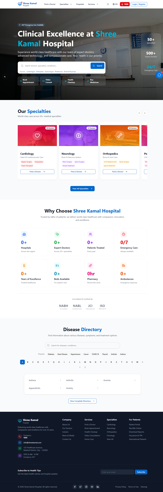
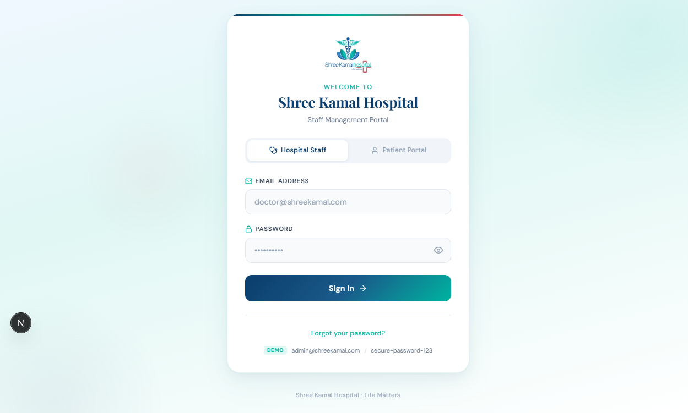
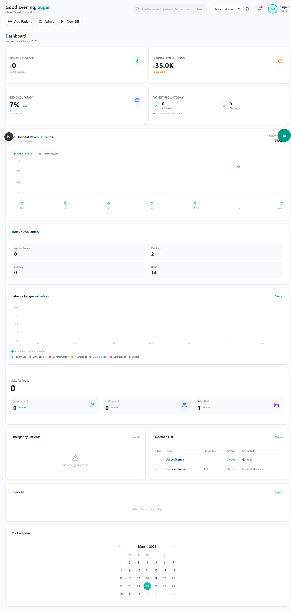
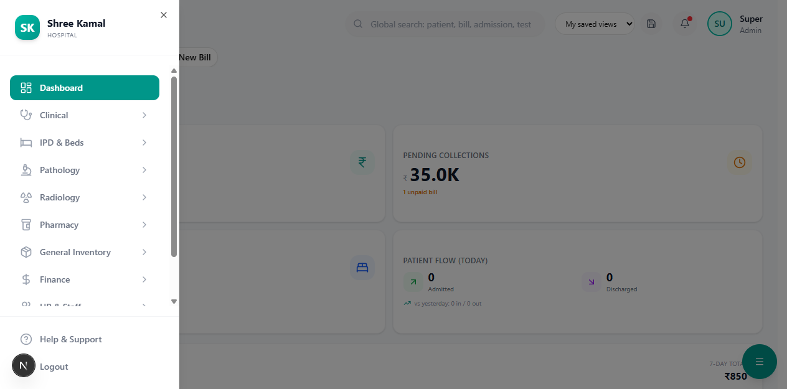

# Login & First Steps

This guide walks you through logging into the system and navigating to your workspace.

---

## Step 1 — Open the Login Page

Open your browser and go to your hospital's URL. You will see the login screen.

---

## Step 2 — Enter Your Credentials

Enter the **email** and **password** provided by your administrator.

| Field | Example |
|-------|---------|
| Email | `doctor@hospital.com` |
| Password | Your assigned password |

Click the **Sign In** button.

> **Tip:** If you forget your password, contact your System Administrator (SUPER_ADMIN) to reset it.

---

## Step 3 — You're on the Dashboard

After successful login, you'll be taken directly to the **Dashboard**.

What you see depends on your **role**:

| Role | What You See |
|------|-------------|
| **SUPER_ADMIN** | Full dashboard with all modules |
| **DOCTOR** | Clinical modules (OPD, OT, EMR, IPD) |
| **RECEPTIONIST** | Insurance verification, Registration, Appointments |
| **ACCOUNTANT** | Finance, Billing, Insurance Claims, Reports |
| **PHARMACIST** | Pharmacy POS, Inventory |
| **LAB_TECHNICIAN** | Pathology queue, Lab reports |
| **NURSE** | IPD, Vitals, Medication administration |

---

## Step 4 — Navigate Using the Sidebar

The **left sidebar** is your main navigation. Click any section to expand its sub-menu.

The sidebar contains these sections:

1. **Dashboard** — Overview and statistics
2. **Clinical** — OPD, OT, EMR
3. **IPD** — Bed management, Admissions
4. **Pathology** — Lab tests and reports
5. **Radiology** — Imaging tests and reports
6. **Pharmacy** — POS billing, Inventory
7. **Finance** — Billing, Purchases, Taxes
8. **Insurance** — Verification, Claims, Pre-Auth
9. **Reports** — Day book, Revenue, GST
10. **HR** — Staff, Roster, Payroll
11. **Admin** — Users, Settings

> **Tip:** The sidebar collapses on smaller screens. Click the hamburger menu icon to expand it.

---

## Step 5 — Log Out

To log out, click your **profile icon** at the bottom of the sidebar and select **Logout**.

---

## Next Steps

- [Dashboard Overview](dashboard-overview.md) — Learn what each dashboard widget shows
- [Insurance Verify & Register](../insurance/verify-register.md) — Start the insurance-first patient registration
