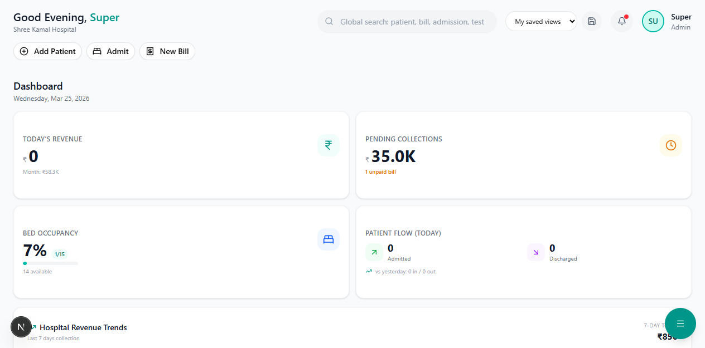
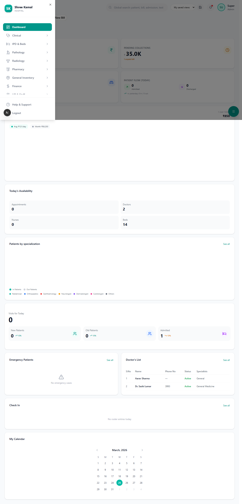

# Dashboard Overview

The Dashboard is the first screen you see after logging in. It gives you a real-time snapshot of hospital operations.

**Route:** `/dashboard`

---

## What You'll See

The dashboard is divided into several widgets:

---

### Revenue Summary

| Metric | Description |
|--------|-------------|
| **Today's Revenue** | Total collections for today (Cash + Card + UPI + Insurance) |
| **This Week** | Running weekly total |
| **This Month** | Monthly revenue with trend comparison |

> **Tip:** Click the revenue card to go to the detailed Finance module.

---

### Doctor Availability

Shows a real-time list of doctors currently available, with their:
- Name and specialization
- Current status (Available / In Consultation / On Leave)
- Number of patients seen today

---

### Patient Statistics

| Stat | Description |
|------|-------------|
| **OPD Queue** | Number of patients currently waiting |
| **IPD Occupancy** | Beds occupied vs total beds (with percentage) |
| **Today's Admissions** | New IPD admissions today |
| **Today's Discharges** | Patients discharged today |

---

### Recent Visits

A live table showing the latest patient interactions:

| Column | Details |
|--------|---------|
| Patient Name | Name with patient ID |
| Doctor | Treating physician |
| Type | OPD / IPD / Emergency |
| Status | Waiting / In-Consultation / Completed |
| Time | Visit timestamp |

---

### Specialization Distribution

A visual chart showing patient visits broken down by department:
- General Medicine
- Orthopedics
- Cardiology
- Gynecology
- Pediatrics
- ENT
- etc.

---

## Quick Actions

From the dashboard, you can quickly navigate to:

| Action | How |
|--------|-----|
| Register new patient | Sidebar → **Insurance** → **Verify & Register** |
| View OPD queue | Sidebar → **Clinical** → **OPD** |
| Check bed availability | Sidebar → **IPD** |
| Create a bill | Sidebar → **Finance** → **Billing** |

---

## Next Steps

- [Insurance Verify & Register](../insurance/verify-register.md) — The primary entry point for new patients
- [OPD Queue Management](../clinical/opd-queue.md) — Managing outpatient flow
