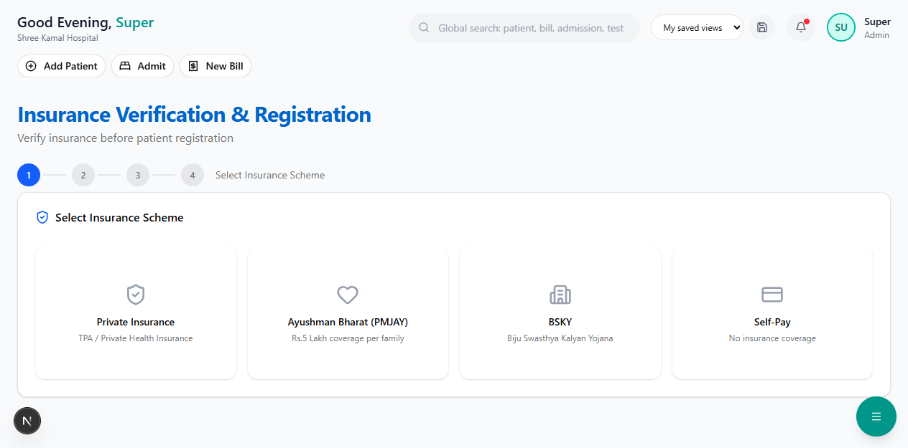

# Insurance Module Overview

The Insurance module is the heart of patient onboarding at Shree Kamal Hospital ERP. It follows Indian healthcare insurance standards set by **IRDAI** (Insurance Regulatory and Development Authority of India).

---

## How It Works

```
Patient Arrives
      |
      v
[1. Select Insurance Scheme]  →  Private / PMJAY / BSKY / Self-Pay
      |
      v
[2. Verify Policy Details]    →  Enter policy number, verify with TPA
      |
      v
[3. Review Coverage]          →  See sum insured, balance, co-pay, limits
      |
      v
[4. Register Patient]         →  Create patient record with insurance linked
      |
      v
[5. Pre-Authorization]        →  Submit pre-auth to TPA (for cashless)
      |
      v
[6. Treatment]                →  Patient receives treatment
      |
      v
[7. Claim Settlement]         →  Cashless or Reimbursement claim
```

> **Key Principle:** Insurance verification happens **BEFORE** patient registration. This ensures coverage is confirmed upfront, reducing claim rejections later.

---

## Supported Insurance Schemes

| Scheme | Type | Coverage | Who's Eligible |
|--------|------|----------|----------------|
| **Private Insurance** | TPA-based | Varies by policy | Anyone with private health insurance |
| **PMJAY (Ayushman Bharat)** | Government | Rs.5,00,000 / family / year | BPL families (pan-India) |
| **BSKY** | State Government | Rs.5,00,000 (Rs.10L for women) | Odisha state residents |
| **CGHS** | Central Government | Varies | Central govt. employees |
| **Self-Pay** | No insurance | N/A | Patients without insurance |

---

## Supported Insurance Companies

The system includes **17 major Indian insurers**:

Star Health, ICICI Lombard, HDFC ERGO, Bajaj Allianz, Niva Bupa, Care Health, New India Assurance, United India Insurance, National Insurance, Oriental Insurance, SBI General, Tata AIG, Reliance General, Aditya Birla Health, Manipal Cigna, Cholamandalam MS, and more.

---

## Supported TPAs

**12 major Third Party Administrators**:

Medi Assist, FHPL (Family Health Plan), Paramount Health, Vidal Health (TTK), Raksha TPA, MD India, Good Health TPA, Star Health TPA, Medsave Health TPA, Heritage Health TPA, United Health TPA, and more.

---

## Sidebar Navigation

All insurance features are accessible from the sidebar under **Insurance**:



| Menu Item | What It Does |
|-----------|-------------|
| Verify & Register | Insurance-first patient registration |
| Active Policies | View all registered policies |
| Pre-Authorization | Manage TPA pre-auth requests |
| Cost Estimator | Estimate treatment cost vs coverage |
| Cashless Claims | Track cashless claims with TPAs |
| Reimbursement | Track reimbursement claims |
| PMJAY Claims | Ayushman Bharat specific claims |
| Tariff Master | Hospital rate card |
| ICD-10 Codes | Diagnosis code browser |

---

## Next Steps

Start with the most important flow:

- [Verify & Register Patient](verify-register.md) — The primary entry point
