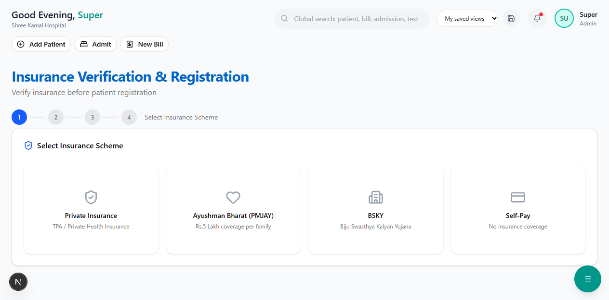

# Verify & Register Patient

This is the **primary entry point** for onboarding new patients. Insurance is verified before registration to ensure coverage is confirmed upfront.

**Route:** `/dashboard/insurance/verify`

**Sidebar:** Insurance → Verify & Register

---

## Step 1 — Select Insurance Scheme

When you open the page, you'll see four scheme options as visual cards.

Click the card that matches the patient's insurance:

| Card | When to Select |
|------|---------------|
| **Private Insurance** | Patient has a health insurance policy from a private company (Star Health, ICICI Lombard, etc.) |
| **Ayushman Bharat (PMJAY)** | Patient has an Ayushman Bharat / Jan Arogya card |
| **BSKY** | Patient has a Biju Swasthya Kalyan Yojana card (Odisha) |
| **Self-Pay** | Patient has no insurance (skips to Step 4 directly) |

> **Tip:** If the patient selects **Self-Pay**, they skip directly to the registration form.

---

## Step 2 — Enter Policy Details

The form changes based on the scheme selected in Step 1.

---

### For Private Insurance

Fill in the following fields:

| Field | Required | Description |
|-------|----------|-------------|
| **Policy Number** | Yes | The policy number printed on the health card (e.g., POL-12345678) |
| **Insurance Company** | Yes | Select from dropdown (17 major Indian insurers) |
| **TPA Name** | No | Select the TPA handling claims (e.g., Medi Assist, FHPL) |
| **Health Card Number** | No | Member ID / Card number |
| **Policy Type** | No | Individual / Family Floater / Group (Corporate) |
| **Sum Insured (Rs.)** | Yes | Total policy amount (e.g., 500000) |
| **Balance Available (Rs.)** | No | Remaining balance if partially used |
| **Policy Start Date** | Yes | When the policy started |
| **Policy End Date** | Yes | When the policy expires |

**Sub-Limits & Restrictions** (scroll down):

| Field | Description |
|-------|-------------|
| **Room Rent Cap (Rs./day)** | Maximum room rent covered per day |
| **ICU Rent Cap (Rs./day)** | Maximum ICU charges covered per day |
| **Co-pay (%)** | Percentage patient must pay (e.g., 10%, 20%) |
| **Deductible (Rs.)** | Fixed amount patient pays before insurance starts |
| **Network Hospital?** | Whether this hospital is in the insurer's network |

> **Important:** Sub-limits directly affect the cost estimation. If the room rent cap is set, a **proportional deduction** applies to ALL expenses — not just room rent. This follows IRDAI norms.

---

### For PMJAY (Ayushman Bharat)

| Field | Required | Description |
|-------|----------|-------------|
| **Ayushman Bharat ID** | Yes | 14-digit beneficiary ID (e.g., AB-12-34-567890) |
| **ABHA Number** | No | Ayushman Bharat Health Account number |
| **Aadhaar Number** | Yes | 12-digit Aadhaar for identity verification |
| **Family ID** | No | PMJAY family identifier |
| **Mobile Number** | No | Registered mobile for OTP verification |

A green info box reminds you:

> Rs.5,00,000 per family per year for secondary and tertiary hospitalization. Covers pre and post hospitalization expenses. Package-based pricing applies.

---

### For BSKY

| Field | Required | Description |
|-------|----------|-------------|
| **BSKY Card Number** | Yes | Card number from the BSKY card |
| **Aadhaar Number** | Yes | 12-digit Aadhaar |
| **Mobile Number** | No | Registered mobile |

An orange info box reminds you:

> Rs.5,00,000 per family per year and Rs.10,00,000 for women members. Applicable in Odisha state empanelled hospitals.

---

### Click "Verify Policy"

After filling the form, click the **Verify Policy** button.

The system will:
1. Check if this policy already exists in the database
2. If found — show existing patient details and coverage
3. If not found — show a message to proceed with new registration

---

## Step 3 — Review Coverage

After verification, you'll see the **Coverage Summary Card**.

This card shows:

| Section | What It Shows |
|---------|-------------|
| **Sum Insured** | Total policy amount (e.g., Rs.5,00,000) |
| **Balance Available** | Remaining amount after previous claims |
| **Utilized** | Amount already claimed this year |
| **Utilization Bar** | Visual progress bar showing usage percentage |
| **Insurer / TPA** | Insurance company and TPA name |
| **Policy Number** | For reference |
| **Valid Until** | Policy expiry date |

### Warning Badges

If the policy has restrictions, you'll see amber warning badges:

| Badge | Meaning |
|-------|---------|
| **Co-pay: 10%** | Patient pays 10% of every approved amount |
| **Room Cap: Rs.5,000/day** | Room rent exceeding this triggers proportional deduction |
| **Deductible: Rs.5,000** | First Rs.5,000 is always paid by patient |

> **Warning:** If the policy is **expired** or **inactive**, a red badge will appear. The patient can still be registered but won't be eligible for cashless claims.

Click **Proceed to Registration** to continue.

---

## Step 4 — Register Patient

Fill in the patient's personal details.

| Field | Required | Description |
|-------|----------|-------------|
| **Full Name** | Yes | Patient's full name |
| **Phone** | Yes | 10-digit mobile number |
| **Email** | No | Email address (optional) |
| **Gender** | No | Male / Female / Other |
| **Date of Birth** | No | For age calculation |
| **Blood Group** | No | A+, B+, O+, AB+, etc. |
| **Aadhaar Number** | No | 12-digit Aadhaar (may already be filled from Step 2) |
| **Address** | No | Street address |
| **City** | No | City name |
| **State** | No | State name |
| **Pincode** | No | 6-digit postal code |

> **Note:** If the patient was verified via PMJAY or BSKY, a badge shows next to the title: **"PMJAY Linked"** or **"BSKY Linked"**.

Click **Register Patient** to complete.

---

## What Happens After Registration

1. A **Patient ID** is generated (e.g., `PAT-2026-0042`)
2. The insurance policy is **linked** to the patient automatically
3. You'll see a green success message with the Patient ID
4. The patient is now ready for:
   - OPD consultation
   - IPD admission
   - Pre-authorization request (for cashless)

---

## Next Steps

- [Pre-Authorization](pre-authorization.md) — Submit pre-auth to TPA for cashless treatment
- [Cost Estimator](cost-estimator.md) — Estimate how much insurance covers
- [Active Policies](active-policies.md) — View all registered policies
