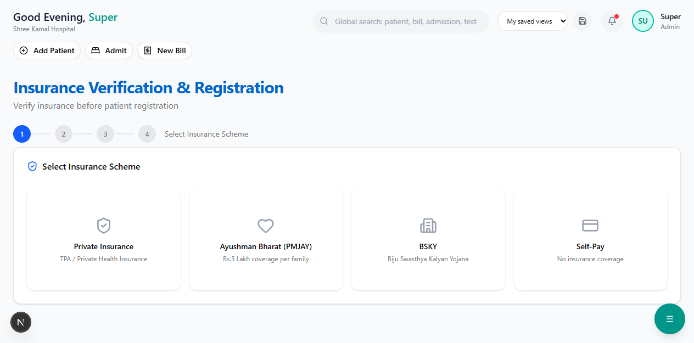

# Active Policies

View all patients with active insurance coverage, organized by scheme type.

**Route:** `/dashboard/insurance/policies`

**Sidebar:** Insurance → Active Policies

---

## Overview

When you open this page, you'll see two sections:

---

## Scheme Summary Cards

At the top, colored cards show policy counts and total coverage grouped by scheme:

| Card | Shows |
|------|-------|
| **PRIVATE** | Count of private policies + total sum insured |
| **PMJAY** | Count of PMJAY beneficiaries + total coverage |
| **BSKY** | Count of BSKY beneficiaries + total coverage |

---

## Policies Table

Below the cards is a comprehensive table of all active policies:

| Column | Description |
|--------|-------------|
| **Patient** | Patient name and ID (e.g., PAT-2026-0042) |
| **Policy No.** | Insurance policy number |
| **Scheme** | Color-coded badge — blue for PRIVATE, green for PMJAY, orange for BSKY |
| **Provider / TPA** | Insurance company name, with TPA name below |
| **Sum Insured** | Total coverage amount |
| **Balance** | Remaining balance (shown in green) |
| **Valid Until** | Policy expiry date |
| **Claims** | Number of claims filed against this policy |

> **Tip:** Policies close to expiry will show the date in red. Expired policies are automatically marked as inactive.

---

## What You Can Do

| Action | How |
|--------|-----|
| Search for a policy | Use the search bar to find by patient name or policy number |
| View patient details | Click the patient name to view their full profile |
| Check balance | The "Balance" column shows remaining coverage at a glance |
| Track claims | The "Claims" column shows how many claims have been filed |

---

## Next Steps

- [Pre-Authorization](pre-authorization.md) — Submit a pre-auth request for a patient
- [Cashless Claims](cashless-claims.md) — File a cashless claim
