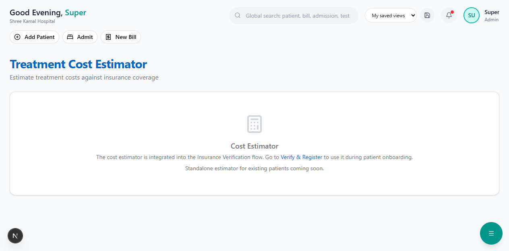

# Cost Estimator

The Cost Estimator calculates how much of a treatment cost will be covered by insurance and how much the patient needs to pay out-of-pocket.

**Route:** `/dashboard/insurance/estimate`

**Sidebar:** Insurance → Cost Estimator

---

## How It Works

The estimator takes into account:

| Factor | What It Does |
|--------|-------------|
| **Hospital Tariff** | Actual rates from the [Tariff Master](tariff-master.md) |
| **Room Rent Cap** | If room rate exceeds the policy cap, a proportional deduction applies to ALL expenses |
| **Co-pay** | Percentage of the approved amount the patient must pay |
| **Deductible** | Fixed amount the patient pays before insurance coverage begins |
| **Balance Available** | Coverage is capped at the remaining policy balance |

---

## The Output

The estimator produces three key numbers:

| Card | Color | Meaning |
|------|-------|---------|
| **Estimated Total Cost** | Blue | Total hospital charges for the treatment |
| **Insurance Covers** | Green | Amount the insurance will pay (with percentage) |
| **You Pay (Estimated)** | Red | Out-of-pocket amount for the patient |

---

## Detailed Line-Item Breakdown

Each service is shown as a row with:

| Column | Description |
|--------|-------------|
| **Service** | Name of the service (e.g., "Room Rent - Private x 3 days") |
| **Rate** | Hospital rate per unit |
| **Qty** | Quantity |
| **Total** | Rate x Quantity |
| **Covered** | Amount insurance will cover (green) |
| **You Pay** | Amount patient pays for this service (red) |

If a sub-limit applies, a small amber note appears below the service name.

---

## Warning Messages

The estimator shows amber warning boxes for any restrictions:

| Warning | Meaning |
|---------|---------|
| **Room rent exceeds policy cap** | Room rate is higher than the cap. Proportional deduction will apply to ALL expenses. |
| **Co-pay of X% applies** | Patient pays X% of every covered amount |
| **Deductible of Rs.X applies** | First Rs.X is always patient's responsibility |
| **Coverage capped at available balance** | The remaining balance is less than the estimated coverage |

---

## Understanding Room Rent Proportional Deduction

This is an IRDAI-standard rule that many patients find confusing. Here's how it works:

> **Example:**
> - Policy room rent cap: **Rs.3,000/day**
> - Actual room rate: **Rs.5,000/day**
> - Proportional Factor: 3,000 / 5,000 = **0.60 (60%)**
>
> This means **ALL expenses** (not just room rent) are reduced to 60% for insurance coverage.
>
> | Expense | Hospital Bill | Insurance Covers (60%) | Patient Pays |
> |---------|--------------|----------------------|-------------|
> | Room Rent (3 days) | Rs.15,000 | Rs.9,000 | Rs.6,000 |
> | Surgery | Rs.45,000 | Rs.27,000 | Rs.18,000 |
> | Medicines | Rs.5,000 | Rs.3,000 | Rs.2,000 |
> | **Total** | **Rs.65,000** | **Rs.39,000** | **Rs.26,000** |

> **Tip:** Always advise the patient to choose a room within their policy's room rent cap to maximize coverage.

---

## Deductions Summary

A dedicated card shows all deductions:

| Deduction | How It's Calculated |
|-----------|-------------------|
| Co-pay | Approved Amount x Co-pay Percentage |
| Deductible | Fixed amount from policy |
| Room Rent Proportional Deduction | Total Cost x (1 - Proportional Factor) |
| **Total Deductions** | Sum of all above |

---

## Where to Access

The Cost Estimator is integrated into:

1. **Insurance Verification flow** — During Step 3 (Review Coverage)
2. **Pre-Authorization form** — Cost breakdown section
3. **Standalone page** — `/dashboard/insurance/estimate`

---

## Next Steps

- [Cashless Claims](cashless-claims.md) — File claims after treatment
- [Tariff Master](tariff-master.md) — View and manage hospital tariff rates
