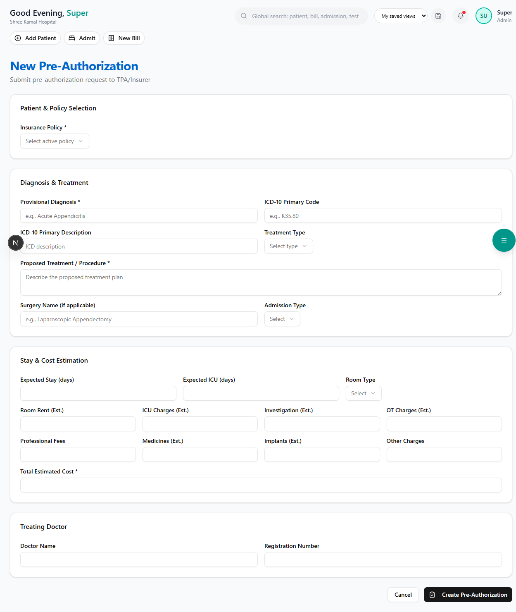
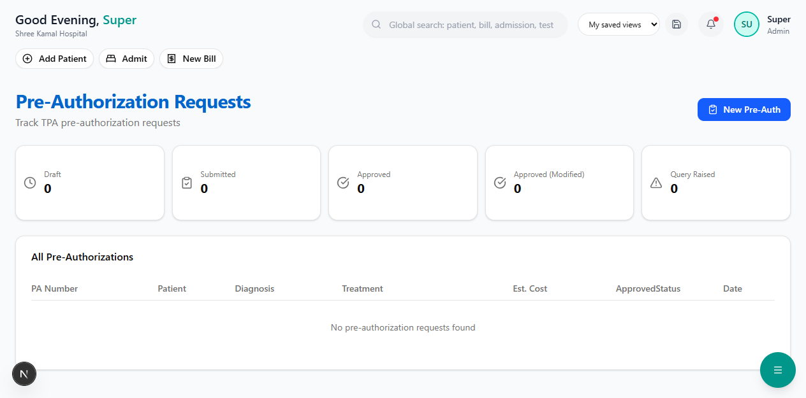

# Pre-Authorization

Pre-authorization (pre-auth) is **mandatory** for cashless claims in Indian health insurance. The hospital submits a request to the TPA/insurer before or during admission, and the TPA approves a coverage amount.

**Route:** `/dashboard/insurance/pre-auth`

**Sidebar:** Insurance → Pre-Authorization

---

## Understanding the Pre-Auth Workflow

```
DRAFT  →  SUBMITTED  →  TPA Reviews  →  APPROVED
                                      →  APPROVED (Modified)
                                      →  QUERY RAISED
                                      →  REJECTED
                                              |
                                     ENHANCEMENT REQUESTED  →  ENHANCEMENT APPROVED
                                              |
                                     DISCHARGE APPROVED  →  Final Settlement
```

> **Important:** Without pre-authorization approval, the TPA will not process a cashless claim. Always submit pre-auth **before or immediately after** admission.

---

## Pre-Auth Dashboard


### Status Cards

At the top, you'll see quick count cards:

| Status | Meaning |
|--------|---------|
| **Draft** | Created but not yet submitted to TPA |
| **Submitted** | Sent to TPA, awaiting response |
| **Approved** | TPA approved the coverage amount |
| **Query Raised** | TPA needs additional information or documents |
| **Rejected** | TPA denied the pre-authorization |

### Pre-Auth Table

| Column | Description |
|--------|-------------|
| **PA Number** | Pre-authorization number (e.g., PA-2026-0001) — click to view details |
| **Patient** | Patient name |
| **Diagnosis** | Provisional diagnosis with ICD-10 code |
| **Treatment** | Proposed treatment / procedure |
| **Est. Cost** | Total estimated treatment cost |
| **Approved** | Amount approved by TPA (green, if approved) |
| **Status** | Color-coded status badge |
| **Date** | Date of creation |

---

## Creating a New Pre-Auth

Click the **"New Pre-Auth"** button in the top right corner.

**Route:** `/dashboard/insurance/pre-auth/create`



### Section 1 — Patient & Policy Selection

| Field | Description |
|-------|-------------|
| **Insurance Policy** | Select from dropdown of active policies. Shows patient name, policy number, and scheme type. |

Once selected, an info box shows:
- Patient name
- Insurer name
- Available balance

---

### Section 2 — Diagnosis & Treatment


| Field | Required | Description |
|-------|----------|-------------|
| **Provisional Diagnosis** | Yes | e.g., "Acute Appendicitis" |
| **ICD-10 Primary Code** | No | e.g., K35.80 (searchable from ICD-10 database) |
| **ICD-10 Description** | No | Auto-filled when code is entered |
| **Treatment Type** | No | Medical Management / Surgical / Day Care / Maternity |
| **Proposed Treatment** | Yes | Detailed treatment plan (text area) |
| **Surgery Name** | No | e.g., "Laparoscopic Appendectomy" |
| **Admission Type** | No | Emergency / Planned |

> **Tip:** Use the [ICD-10 Code Browser](icd-codes.md) to look up the correct diagnosis code. Correct coding improves claim approval rates.

---

### Section 3 — Stay & Cost Estimation


**Stay Details:**

| Field | Description |
|-------|-------------|
| Expected Stay (days) | Estimated number of hospital days |
| Expected ICU (days) | Estimated ICU days (if any) |
| Room Type | General Ward / Semi Private / Private / Deluxe |

**Cost Breakdown (8 categories):**

| Category | Example Amount |
|----------|---------------|
| Room Rent | Rs. 15,000 (3 days x Rs. 5,000) |
| ICU Charges | Rs. 0 |
| Investigation | Rs. 5,000 |
| OT Charges | Rs. 15,000 |
| Professional Fees | Rs. 10,000 |
| Medicines | Rs. 3,000 |
| Implants | Rs. 0 |
| Other Charges | Rs. 2,000 |
| **Total Estimated Cost** | **Rs. 50,000** |

---

### Section 4 — Treating Doctor

| Field | Description |
|-------|-------------|
| Doctor Name | Name of the treating physician |
| Registration Number | Medical council registration number |

---

### Submit

Click **"Create Pre-Authorization"** to save as a draft. You can then submit it to the TPA from the detail page.

---

## Pre-Auth Detail View

Click any PA Number in the list to view its full details.

**Route:** `/dashboard/insurance/pre-auth/[id]`



The detail page shows:

1. **Status Badge** — Large colored badge showing current status
2. **Patient Information** — Name, policy number, insurer, scheme
3. **Diagnosis** — Provisional diagnosis, ICD-10 code, proposed treatment
4. **Cost Breakdown** — All 8 cost categories with total
5. **Approved Amount** — (if approved) Amount sanctioned by TPA
6. **TPA Response** — Remarks, query details, or rejection reason
7. **Enhancement** — If additional funds were requested

---

## Handling TPA Responses

| TPA Response | What To Do |
|-------------|------------|
| **Approved** | Proceed with treatment. Amount is locked for cashless billing. |
| **Approved with Modification** | TPA approved a lower amount. Review and inform patient of the shortfall. |
| **Query Raised** | TPA needs more info. Gather documents and respond. |
| **Rejected** | Inform patient. Options: appeal, switch to reimbursement, or self-pay. |

---

## Requesting Enhancement

If treatment costs exceed the approved amount, you can request an **enhancement**:

| Field | Description |
|-------|-------------|
| Enhancement Amount | Additional amount needed |
| Enhancement Reason | Why the original estimate was insufficient |

The TPA reviews and approves/rejects the enhancement.

---

## Next Steps

- [Cost Estimator](cost-estimator.md) — Get a detailed breakdown before submitting pre-auth
- [Cashless Claims](cashless-claims.md) — File a cashless claim after treatment
