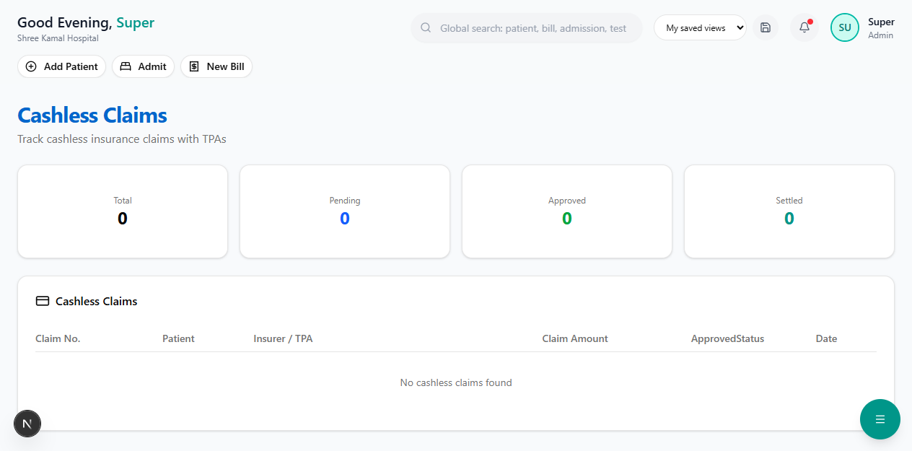

# Cashless Claims

In a cashless claim, the **hospital settles directly with the TPA/insurer** — the patient pays only the deductible, co-pay, and non-covered charges.

**Route:** `/dashboard/insurance/claims/cashless`

**Sidebar:** Insurance → Cashless Claims

---

## Dashboard

### Summary Cards

| Card | Description |
|------|-------------|
| **Total** | Total cashless claims filed |
| **Pending** | Claims in Submitted / Under Review / In Process status |
| **Approved** | Claims approved, awaiting settlement |
| **Settled** | Claims fully settled — payment received from TPA |

---

## Claims Table

| Column | Description |
|--------|-------------|
| **Claim No.** | Unique claim number (e.g., CLM-2026-00001) |
| **Patient** | Patient name |
| **Insurer / TPA** | Insurance company and TPA name |
| **Claim Amount** | Total amount claimed |
| **Approved** | Amount approved by TPA (green) |
| **Status** | Color-coded badge |
| **Date** | Submission date |

---

## Claim Status Lifecycle

| Status | Color | Meaning |
|--------|-------|---------|
| **SUBMITTED** | Blue | Claim sent to TPA |
| **UNDER_REVIEW** | Yellow | TPA reviewing documents |
| **IN_PROCESS** | Purple | Claim being processed |
| **APPROVED** | Green | Amount approved, awaiting payment |
| **SETTLED** | Teal | Payment received from TPA |
| **QUERY_RAISED** | Amber | TPA needs additional documents or information |
| **REJECTED** | Red | Claim denied by TPA |

---

## How to Create a Cashless Claim

1. Ensure a **Pre-Authorization** has been approved for the patient
2. Complete the patient's treatment and generate the final **billing**
3. The cashless claim is created linking the policy, billing, and pre-auth
4. Submit to TPA for settlement

> **Important:** The pre-authorization approval letter and the final discharge summary are the two most critical documents for claim settlement.

---

## Next Steps

- [Reimbursement Claims](reimbursement-claims.md) — For patients who paid upfront
- [Pre-Authorization](pre-authorization.md) — Submit pre-auth before cashless claim
