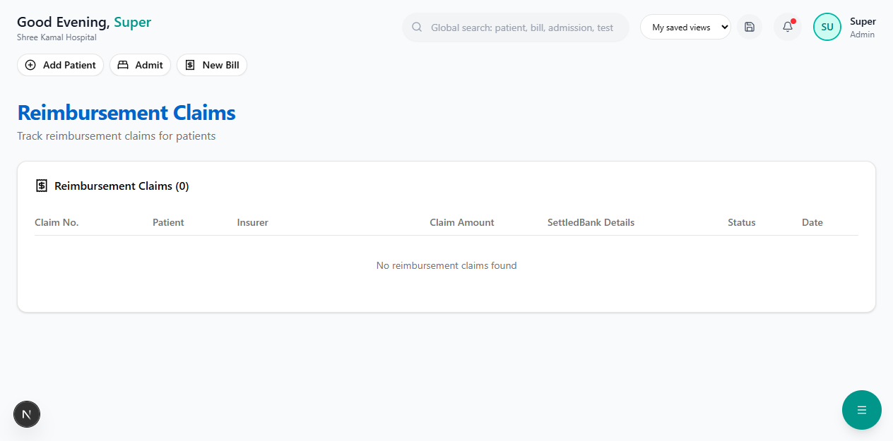

# Reimbursement Claims

In a reimbursement claim, the **patient pays the hospital bill upfront** and later submits a claim to the insurer for reimbursement.

**Route:** `/dashboard/insurance/claims/reimbursement`

**Sidebar:** Insurance → Reimbursement

---

## When to Use Reimbursement

| Scenario | Use Reimbursement |
|----------|------------------|
| Non-network hospital | Yes — cashless not available |
| Pre-auth rejected | Yes — patient pays, claims later |
| Emergency admission without pre-auth | Yes |
| Patient prefers to pay and claim | Yes |

---

## Claims Table

| Column | Description |
|--------|-------------|
| **Claim No.** | Unique number (e.g., RMB-2026-00001) |
| **Patient** | Patient name |
| **Insurer** | Insurance company |
| **Claim Amount** | Amount claimed for reimbursement |
| **Settled** | Amount received back from insurer (green) |
| **Bank Details** | Bank name and last 4 digits of account |
| **Status** | Color-coded status badge |
| **Date** | Submission date |

---

## Additional Fields for Reimbursement

Unlike cashless claims, reimbursement requires **bank details** for fund transfer:

| Field | Required | Description |
|-------|----------|-------------|
| **Bank Account Number** | Yes | Patient's bank account for receiving reimbursement |
| **Bank Name** | Yes | Name of the bank |
| **IFSC Code** | Yes | Branch IFSC code |
| **PAN Number** | Conditional | Mandatory for claims above Rs.1,00,000 (per IT Act) |

> **Important:** Ensure the bank details are correct. Incorrect details cause delays in settlement.

---

## Next Steps

- [PMJAY Claims](pmjay-claims.md) — Government scheme specific claims
- [Cashless Claims](cashless-claims.md) — For direct settlement claims
