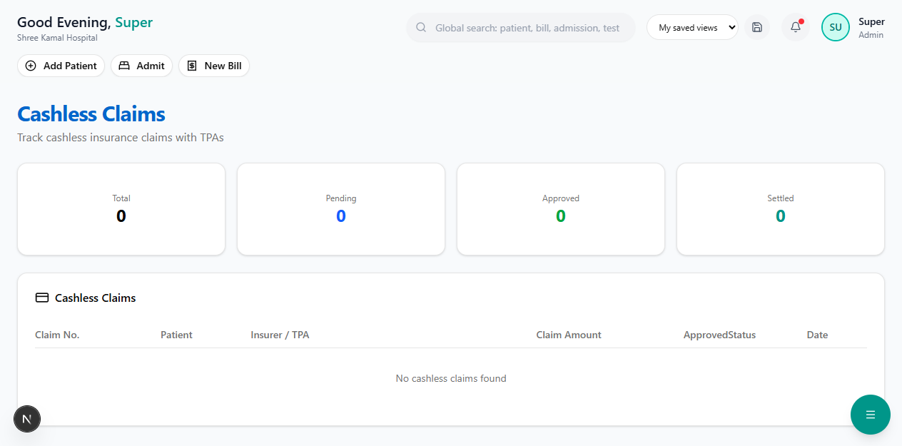

# PMJAY Claims (Ayushman Bharat)

A dedicated dashboard for tracking claims under the **Pradhan Mantri Jan Arogya Yojana (PMJAY)** — India's largest government health insurance scheme.

**Route:** `/dashboard/finance/pmjay-claims`

**Sidebar:** Insurance → PMJAY Claims

---

## About PMJAY

| Detail | Value |
|--------|-------|
| **Full Name** | Pradhan Mantri Jan Arogya Yojana |
| **Coverage** | Rs.5,00,000 per family per year |
| **Eligibility** | BPL families identified via SECC data |
| **Pricing** | Package-based (fixed rates per procedure) |
| **Scheme Authority** | National Health Authority (NHA) |

---

## Dashboard

### Summary Cards

| Card | Description |
|------|-------------|
| **Total Claims** | Number of PMJAY claims filed |
| **Total Claimed** | Total amount claimed from NHA |
| **Total Approved** | Total amount approved |
| **Pending** | Claims not yet settled |

---

## Claims Table

| Column | Description |
|--------|-------------|
| **Claim No.** | Claim reference number |
| **Patient** | Beneficiary name |
| **Ayushman ID** | 14-digit PMJAY beneficiary ID |
| **Claim Amount** | Amount claimed (based on package rate) |
| **Approved** | Amount approved by SHA/NHA |
| **Type** | CASHLESS or REIMBURSEMENT |
| **Status** | Current claim status |
| **Date** | Submission date |

> **Note:** PMJAY claims use **package-based pricing** from the PMJAY rate card, not hospital tariff rates. These rates are pre-defined by NHA for each procedure.

---

## PMJAY Package Rates

The system stores PMJAY rates alongside hospital rates in the [Tariff Master](tariff-master.md). For example:

| Procedure | Hospital Rate | PMJAY Rate |
|-----------|--------------|------------|
| Laparoscopic Appendectomy | Rs.45,000 | Rs.30,000 |
| Caesarean Section | Rs.40,000 | Rs.20,000 |
| Total Knee Replacement | Rs.2,00,000 | Rs.80,000 |
| CABG (Heart Bypass) | Rs.3,00,000 | Rs.1,20,000 |

---

## Next Steps

- [Tariff Master](tariff-master.md) — View hospital and PMJAY rates
- [Verify & Register](verify-register.md) — Register a new PMJAY beneficiary
