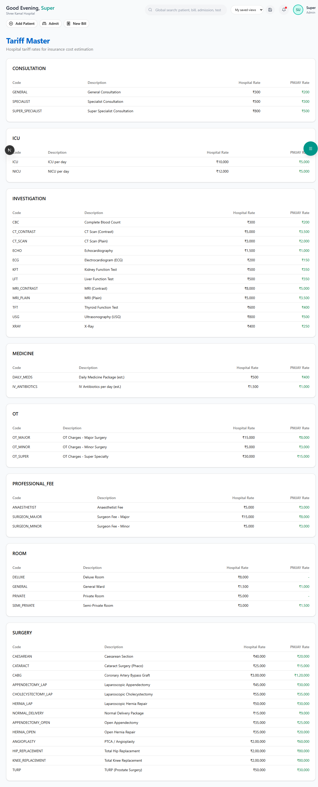

# Tariff Master

The Tariff Master is the hospital's **official rate card**. It stores prices for all services, procedures, rooms, and investigations. These rates are used for billing and insurance cost estimation.

**Route:** `/dashboard/insurance/tariff`

**Sidebar:** Insurance → Tariff Master

---

## Page Layout



Tariffs are organized by **category**, with each category displayed as a separate card:

---

## Categories & Sample Rates

### Room Charges

| Code | Description | Hospital Rate | PMJAY Rate |
|------|-------------|--------------|------------|
| GENERAL | General Ward | Rs.1,500/day | Rs.1,000 |
| SEMI_PRIVATE | Semi-Private Room | Rs.3,000/day | Rs.1,500 |
| PRIVATE | Private Room | Rs.5,000/day | — |
| DELUXE | Deluxe Room | Rs.8,000/day | — |

### ICU Charges

| Code | Description | Hospital Rate | PMJAY Rate |
|------|-------------|--------------|------------|
| ICU | ICU per day | Rs.10,000 | Rs.5,000 |
| NICU | NICU per day | Rs.12,000 | Rs.5,000 |

### Operation Theatre

| Code | Description | Hospital Rate | PMJAY Rate |
|------|-------------|--------------|------------|
| OT_MINOR | Minor Surgery | Rs.5,000 | Rs.3,000 |
| OT_MAJOR | Major Surgery | Rs.15,000 | Rs.8,000 |
| OT_SUPER | Super Specialty | Rs.30,000 | Rs.15,000 |

### Investigations

| Code | Description | Hospital Rate | PMJAY Rate |
|------|-------------|--------------|------------|
| CBC | Complete Blood Count | Rs.300 | Rs.200 |
| XRAY | X-Ray | Rs.400 | Rs.250 |
| CT_SCAN | CT Scan (Plain) | Rs.3,000 | Rs.2,000 |
| MRI_PLAIN | MRI (Plain) | Rs.5,000 | Rs.3,500 |
| ECHO | Echocardiography | Rs.1,500 | Rs.1,000 |

### Surgeries

| Code | Description | Hospital Rate | PMJAY Rate |
|------|-------------|--------------|------------|
| APPENDECTOMY_LAP | Laparoscopic Appendectomy | Rs.45,000 | Rs.30,000 |
| CHOLECYSTECTOMY_LAP | Laparoscopic Cholecystectomy | Rs.55,000 | Rs.35,000 |
| CAESAREAN | Caesarean Section | Rs.40,000 | Rs.20,000 |
| KNEE_REPLACEMENT | Total Knee Replacement | Rs.2,00,000 | Rs.80,000 |
| CABG | Coronary Artery Bypass | Rs.3,00,000 | Rs.1,20,000 |
| CATARACT | Cataract Surgery (Phaco) | Rs.25,000 | Rs.15,000 |

> **Note:** PMJAY rates are fixed package rates defined by NHA. A dash (—) means the service is not available under PMJAY.

---

## Seeding Tariff Data

If the tariff page is empty, run the seed script:

```bash
npx tsx prisma/seed-insurance.ts
```

This loads 42 default tariff items across 8 categories.

---

## Next Steps

- [ICD-10 Codes](icd-codes.md) — Browse diagnosis codes
- [Cost Estimator](cost-estimator.md) — Use tariff rates for cost estimation
