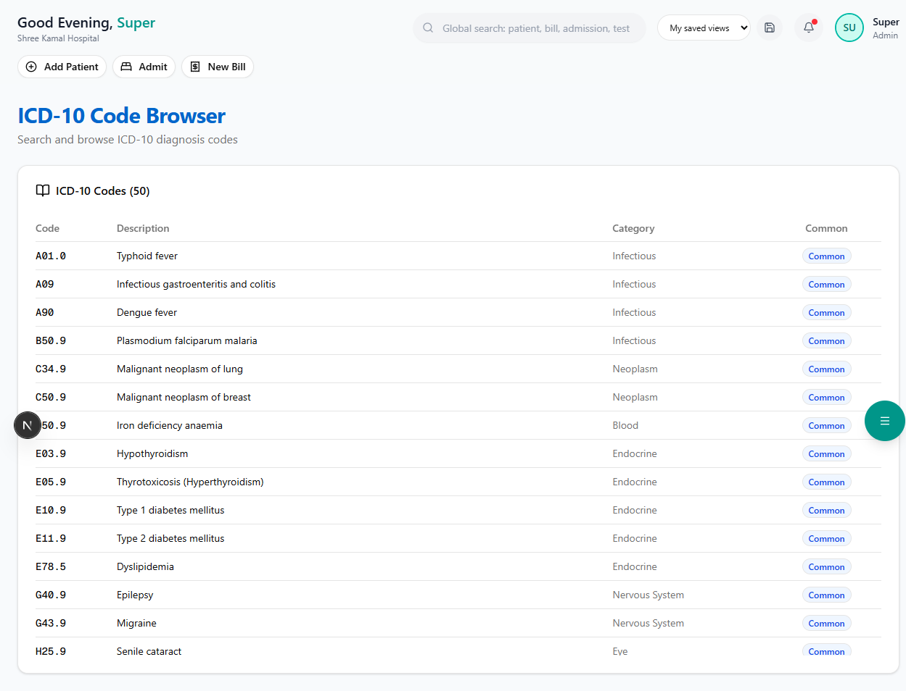

# ICD-10 Code Browser

ICD-10 (International Classification of Diseases, 10th Revision) codes are **mandatory** for insurance claims in India. This browser lets you look up the correct code for any diagnosis.

**Route:** `/dashboard/insurance/icd-codes`

**Sidebar:** Insurance → ICD-10 Codes

---

## Page Layout



A scrollable table showing all loaded ICD-10 codes:

| Column | Description |
|--------|-------------|
| **Code** | The ICD-10 code in monospace font (e.g., K35.80) |
| **Description** | Full description of the diagnosis |
| **Category** | Disease category (e.g., Digestive, Circulatory, Respiratory) |
| **Common** | Blue "Common" badge for frequently used codes |

---

## Available Categories

| Category | Example Codes |
|----------|--------------|
| **Infectious** | A09 (Gastroenteritis), A90 (Dengue), A01.0 (Typhoid), B50.9 (Malaria) |
| **Neoplasm** | C50.9 (Breast Cancer), C34.9 (Lung Cancer) |
| **Endocrine** | E11.9 (Type 2 Diabetes), E03.9 (Hypothyroidism), E78.5 (Dyslipidemia) |
| **Circulatory** | I10 (Hypertension), I21.9 (Heart Attack), I63.9 (Stroke) |
| **Respiratory** | J18.9 (Pneumonia), J45.9 (Asthma), J44.1 (COPD) |
| **Digestive** | K35.80 (Appendicitis), K80.2 (Gallstone), K85.9 (Pancreatitis) |
| **Genitourinary** | N20.0 (Kidney Stone), N39.0 (UTI), N18.9 (CKD) |
| **Musculoskeletal** | M17.9 (Knee Arthritis), M54.5 (Low Back Pain) |
| **Pregnancy** | O80 (Normal Delivery), O82 (Caesarean) |
| **Injury** | S72.0 (Hip Fracture), S06.0 (Concussion) |
| **Eye** | H25.9 (Cataract) |

> **Tip:** The system comes pre-loaded with **50 commonly used ICD-10 codes** covering the most frequent diagnoses seen in Indian hospitals. Codes marked "Common" appear first in search results.

---

## How to Use ICD-10 Codes

ICD-10 codes are used in:

1. **Pre-Authorization forms** — Primary and secondary diagnosis codes
2. **Discharge summaries** — Final diagnosis coding
3. **Insurance claims** — Mandatory for TPA processing

> **Important:** Using the correct ICD-10 code is critical for claim approval. An incorrect or vague code (like "R50.9 - Fever") may lead to queries or rejections from the TPA.

---

## Seeding ICD-10 Data

If the page is empty, run the seed script:

```bash
npx tsx prisma/seed-insurance.ts
```

This loads 50 common ICD-10 codes across 11 categories.
