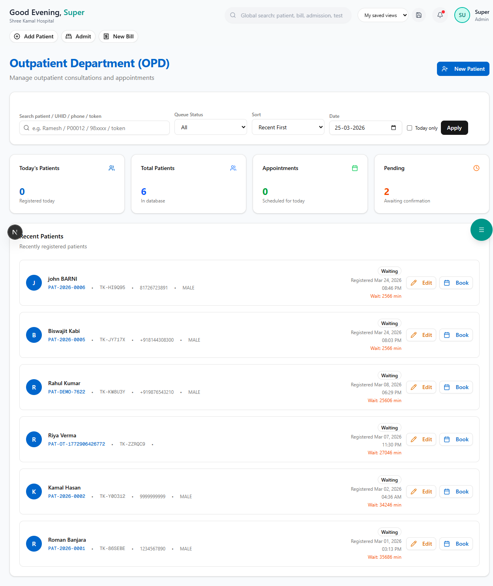

# OPD Queue Management

The OPD module manages the outpatient department workflow — from patient check-in to consultation completion.

**Route:** `/dashboard/clinical/opd`

**Sidebar:** Clinical → OPD

---

## How the OPD Queue Works

```
Patient Arrives → Check-In at Reception → Added to Queue → Vitals Recorded → Doctor Consults → Completed
```

---

## Queue View



The queue shows all patients for today:

| Column | Description |
|--------|-------------|
| **Token No.** | Sequential number for today's queue |
| **Patient** | Name and Patient ID |
| **Doctor** | Assigned consulting doctor |
| **Status** | Waiting / In-Consultation / Completed |
| **Wait Time** | How long the patient has been waiting |
| **Actions** | Call patient, view details |

---

## Patient Flow

### 1. Check-In

When a patient arrives, the receptionist:
- Searches for the patient (or registers a new one via [Insurance Verify & Register](../insurance/verify-register.md))
- Assigns a doctor
- Adds to today's queue

### 2. Record Vitals

Before the doctor sees the patient, a nurse records:

| Vital | Unit |
|-------|------|
| Blood Pressure | mmHg (e.g., 120/80) |
| Temperature | °F or °C |
| Pulse Rate | bpm |
| SpO2 | % |
| Weight | kg |
| Height | cm |

### 3. Doctor Consultation

The doctor:
- Reviews vitals and patient history
- Records consultation notes (SOAP format)
- Writes prescriptions
- Orders investigations (lab tests, imaging)
- Refers to specialist if needed

### 4. Post-Consultation

After consultation, the patient is directed to:
- **Pharmacy** — To collect prescribed medicines
- **Lab** — For ordered investigations
- **Radiology** — For ordered imaging
- **Billing** — For payment

---

## Next Steps

- [Operation Theatre](operation-theatre.md) — If surgery is recommended
- [Electronic Medical Records](emr.md) — View patient history
