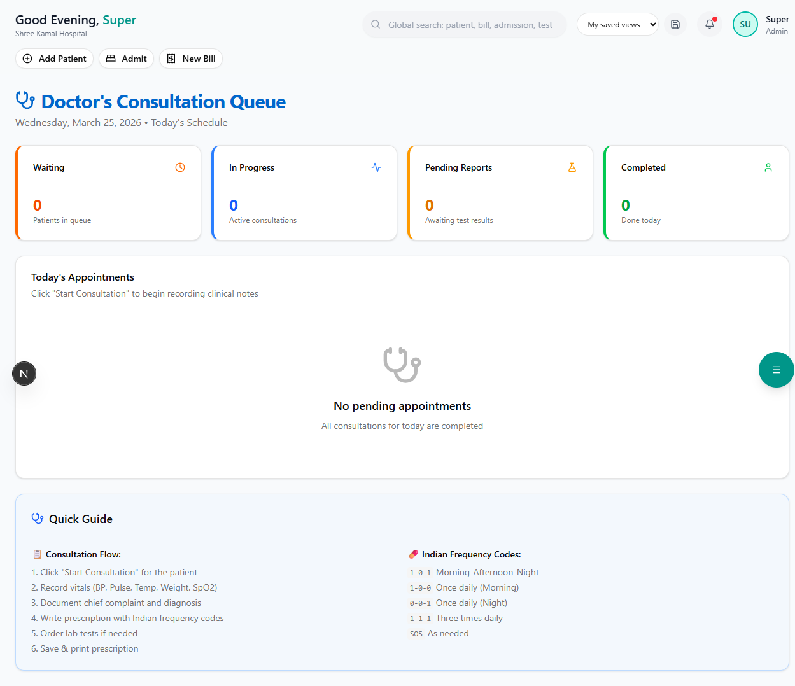

# Electronic Medical Records (EMR)

Maintain complete digital health records for every patient.

**Route:** `/dashboard/clinical/emr`

**Sidebar:** Clinical → EMR

---

## Patient Record Structure

Each patient's EMR contains:

| Section | Contents |
|---------|----------|
| **Demographics** | Name, age, gender, blood group, contact, Aadhaar |
| **Consultation History** | All OPD visits with dates, doctors, and notes |
| **Prescriptions** | All medicines prescribed with dosage and duration |
| **Lab Results** | Pathology reports with reference ranges |
| **Radiology Reports** | Imaging findings and uploaded scans |
| **Admission History** | All IPD admissions, diagnoses, and discharge summaries |
| **Surgery History** | Past surgeries with operative notes |
| **Documents** | Uploaded files (insurance cards, referral letters, external reports) |

---

## Consultation Notes (SOAP Format)

Doctors record consultation notes using the SOAP format:

| Section | Description |
|---------|-------------|
| **S** - Subjective | Patient's complaints in their own words |
| **O** - Objective | Clinical findings, vitals, examination results |
| **A** - Assessment | Doctor's diagnosis / differential diagnosis |
| **P** - Plan | Treatment plan, prescriptions, follow-up |

---

## Document Upload

Upload and attach documents to a patient's record:
- Insurance policy documents
- Referral letters
- External lab/radiology reports
- Consent forms
- Discharge summaries from other hospitals

> **Important:** All uploaded documents are stored securely on AWS S3 and are accessible only by authorized staff.
