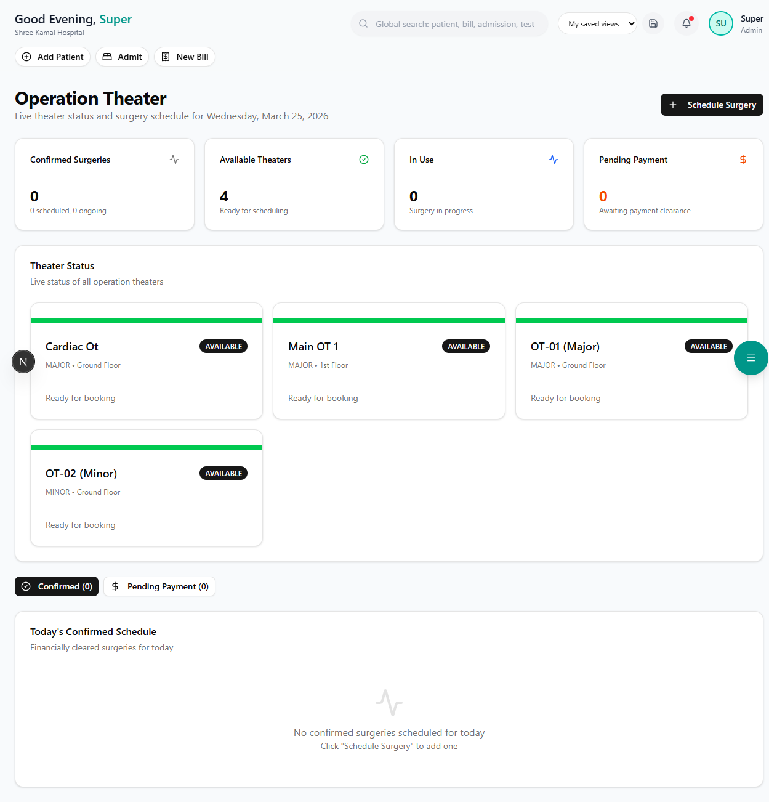

# Operation Theatre (OT)

Schedule, track, and manage surgical operations.

**Route:** `/dashboard/clinical/ot`

**Sidebar:** Clinical → OT

---

## OT Schedule

View the daily and weekly surgery schedule:

| Column | Description |
|--------|-------------|
| **Time** | Scheduled surgery time |
| **OT Room** | Which operation theatre |
| **Patient** | Patient name and ID |
| **Procedure** | Surgery name (e.g., Laparoscopic Appendectomy) |
| **Surgeon** | Primary surgeon |
| **Anesthetist** | Assigned anesthetist |
| **Status** | Scheduled / In-Progress / Completed / Cancelled |

---

## Scheduling a Surgery

1. Click **"Schedule Surgery"**
2. Fill in the details:

| Field | Description |
|-------|-------------|
| Patient | Search and select the patient |
| Procedure | Surgery name and type |
| Surgeon | Select from available doctors |
| Anesthetist | Select anesthetist |
| OT Room | Choose available theatre |
| Date & Time | Surgery date and start time |
| Expected Duration | Estimated surgery duration |
| Special Requirements | Blood units, implants, special equipment |

3. Click **"Schedule"** to confirm

> **Tip:** Ensure the patient has a valid **Pre-Authorization** approval (for insured patients) before scheduling.

---

## Surgery Notes

After the surgery, the surgeon records:
- Intra-operative findings
- Procedure performed
- Blood loss and transfusions
- Implants used (with serial numbers)
- Complications (if any)
- Post-operative orders

---

## Next Steps

- [IPD Bed Management](../ipd/bed-management.md) — Post-surgery bed assignment
- [Pre-Authorization](../insurance/pre-authorization.md) — Insurance approval for surgery
