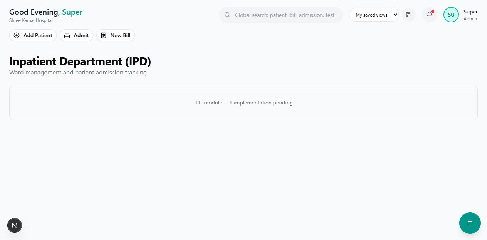

# Admission & Discharge

Manage the complete inpatient workflow from admission to discharge.

**Route:** `/dashboard/ipd/admission`

**Sidebar:** IPD → Admission

---

## Admission Flow

### Step 1 — Select Patient

Search for the patient by name, phone, or patient ID.

> **Note:** If the patient is new, register them first via [Insurance Verify & Register](../insurance/verify-register.md).

### Step 2 — Assign Bed

Select an available bed from the bed map. The system shows:
- Ward type and bed number
- Room rate per day
- Any room-specific amenities

### Step 3 — Assign Doctor

Select the treating physician from the dropdown.

### Step 4 — Enter Diagnosis

| Field | Description |
|-------|-------------|
| Provisional Diagnosis | Initial diagnosis for admission |
| ICD-10 Code | Diagnosis code (optional but recommended for insurance) |
| Reason for Admission | Emergency / Planned / Post-Surgery |

### Step 5 — Link Insurance

If the patient has active insurance, link it for cashless billing:
- Select the active policy
- View coverage summary
- Note if pre-authorization is needed

### Step 6 — Confirm

Click **"Confirm Admission"** to generate:
- Admission ID (e.g., ADM-2026-0001)
- Admission slip (printable)

---

## During Stay

| Activity | Description |
|----------|-------------|
| **Daily Charges** | Room rent is auto-calculated per day |
| **Doctor Rounds** | Record daily progress notes |
| **Nursing Notes** | Medication administration, vitals, observations |
| **Investigation Orders** | Order lab tests and imaging |
| **Pharmacy Orders** | Request medicines from pharmacy |

---

## Discharge Flow

### Step 1 — Doctor Approves Discharge

The treating doctor marks the patient as fit for discharge.

### Step 2 — Generate Discharge Summary

A comprehensive discharge summary is generated including:
- Admission and discharge dates
- Final diagnosis and ICD-10 codes
- Treatment given
- Surgery details (if any)
- Discharge medications
- Follow-up instructions

### Step 3 — Final Billing

All charges are compiled into a final bill:
- Room rent (total days x rate)
- Investigation charges
- Procedure / surgery charges
- Medicine charges
- Professional fees
- Other charges

### Step 4 — Insurance Settlement (if applicable)

For insured patients:
- Compare final bill with pre-auth approved amount
- Calculate patient liability (co-pay, deductible, excess)
- File cashless claim or process reimbursement

### Step 5 — Payment & Discharge

Patient settles any out-of-pocket amount and is formally discharged. The bed is marked as available.

> **Tip:** Print the discharge summary and a copy of the final bill for the patient's records.
