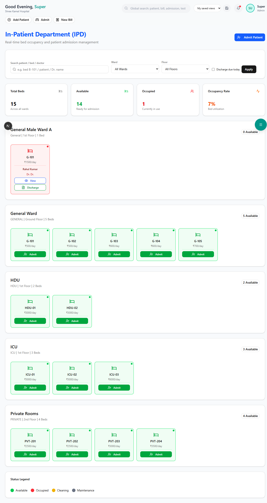

# Bed Management

Manage hospital beds across wards with a visual, color-coded bed map.

**Route:** `/dashboard/ipd`

**Sidebar:** IPD

---

## Visual Bed Map

The bed map shows all beds organized by ward:

| Color | Status | Meaning |
|-------|--------|---------|
| **Green** | Available | Bed is free and ready |
| **Red** | Occupied | Patient currently assigned |
| **Yellow** | Reserved | Reserved for incoming patient |
| **Gray** | Maintenance | Under cleaning or repair |

### How to Use

- **Click a green bed** → Assign a patient (starts admission flow)
- **Click a red bed** → View the assigned patient's details
- **Click a yellow bed** → View reservation details
- **Hover over any bed** → See bed number, ward, and current patient (if occupied)

---

## Ward Types

| Ward | Typical Use |
|------|------------|
| **General Ward** | Standard shared ward |
| **Semi-Private** | 2-bed rooms |
| **Private** | Single occupancy rooms |
| **Deluxe** | Premium rooms |
| **ICU** | Intensive Care Unit |
| **NICU** | Neonatal ICU |
| **Maternity** | Obstetrics ward |
| **Pediatric** | Children's ward |

> **Tip:** The bed map updates in real-time. Refresh the page to see the latest status.

---

## Next Steps

- [Admission & Discharge](admission-discharge.md) — Full admission workflow
