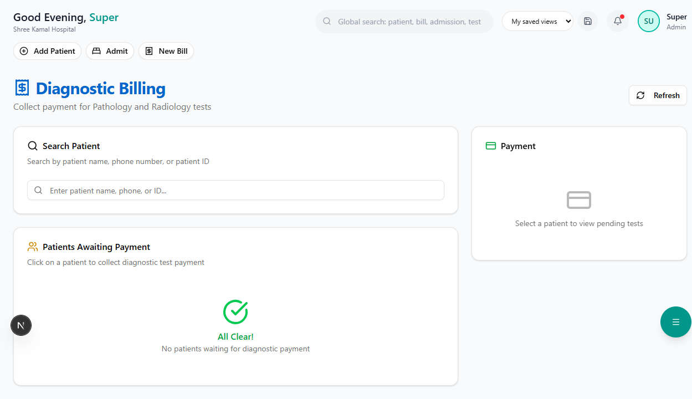

# Pathology / Lab

Manage the complete lab workflow — from sample collection to report generation and verification.

**Route:** `/dashboard/lab`

**Sidebar:** Pathology

---

## Lab Queue

**Route:** `/dashboard/lab/queue`

| Status | Color | Meaning |
|--------|-------|---------|
| **Pending** | Gray | Test ordered, sample not yet collected |
| **Collected** | Blue | Sample received in the lab |
| **Processing** | Purple | Test in progress |
| **Completed** | Green | Results ready for review |
| **Verified** | Teal | Results verified by pathologist |

### Queue Table

| Column | Description |
|--------|-------------|
| Patient | Name and patient ID |
| Test | Test name (e.g., CBC, LFT, KFT) |
| Ordered By | Referring doctor |
| Priority | Normal / Urgent |
| Status | Current status badge |
| Time | When the test was ordered |

---

## Entering Results

1. Click on a test in the queue
2. Enter values for each parameter
3. System auto-flags **abnormal values** (outside reference range) in red
4. Click **"Save Results"**

> **Tip:** Abnormal values are automatically highlighted to draw attention during verification.

---

## Lab Reports

**Route:** `/dashboard/lab/reports`

Generated reports include:
- Hospital header with logo
- Patient details (name, age, gender, patient ID)
- Test parameters with results, units, and reference ranges
- Abnormal flags
- Pathologist signature (digital)
- Date and time

Reports can be:
- **Printed** — For physical records
- **Exported as PDF** — For digital sharing
- **Viewed in EMR** — Automatically linked to patient's medical record

---

## Available Test Categories

| Category | Example Tests |
|----------|--------------|
| Hematology | CBC, ESR, Peripheral Smear |
| Biochemistry | LFT, KFT, Blood Sugar, Lipid Profile |
| Serology | Dengue NS1, Widal, HIV, HBsAg |
| Thyroid | T3, T4, TSH |
| Urine | Urine Routine, Urine Culture |
| Microbiology | Blood Culture, Sputum Culture |
