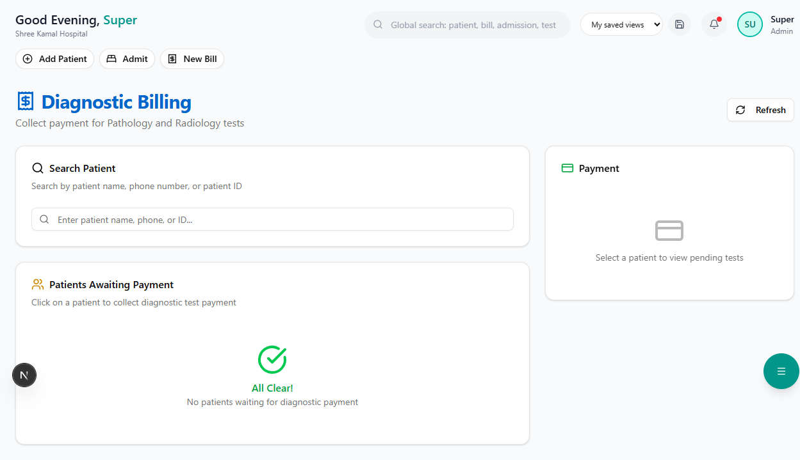

# Radiology

Manage imaging requests, reports, and DICOM image uploads.

**Route:** `/dashboard/radiology`

**Sidebar:** Radiology

---

## Imaging Queue

**Route:** `/dashboard/radiology/queue`

| Column | Description |
|--------|-------------|
| Patient | Name and patient ID |
| Investigation | X-Ray / CT Scan / MRI / USG / ECG |
| Body Part | e.g., Chest, Abdomen, Knee |
| Referred By | Ordering doctor |
| Priority | Normal / Urgent |
| Status | Pending / In-Progress / Completed / Verified |

---

## Generating Reports

**Route:** `/dashboard/radiology/reports`

1. Select the investigation from the queue
2. Enter **Findings** — Detailed observations
3. Enter **Impression** — Summary conclusion
4. Upload images (if applicable)
5. Submit for verification

### Report Template

| Section | Content |
|---------|---------|
| **Patient Info** | Name, age, gender, patient ID |
| **Investigation** | Type and body part |
| **Clinical History** | From the referring doctor |
| **Findings** | Detailed radiological observations |
| **Impression** | Summary and conclusion |
| **Radiologist** | Name and digital signature |

---

## Supported Modalities

| Modality | Use Case |
|----------|---------|
| **X-Ray** | Fractures, chest conditions, abdominal issues |
| **CT Scan** | Detailed cross-sectional imaging |
| **MRI** | Soft tissue, brain, spine imaging |
| **USG (Ultrasound)** | Abdominal, obstetric, vascular imaging |
| **ECG** | Cardiac rhythm recording |
