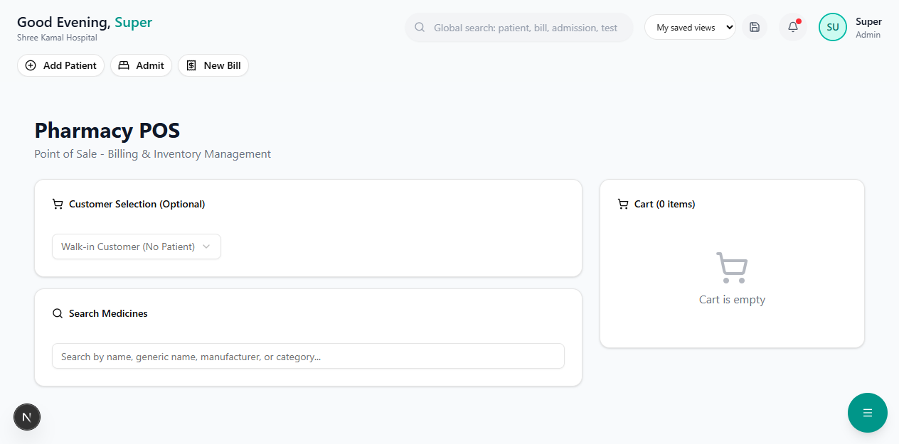

# POS Billing

The Pharmacy POS (Point of Sale) module handles medicine billing, prescription dispensing, and payment collection.

**Route:** `/dashboard/pharmacy/pos/billing`

**Sidebar:** Pharmacy → POS Billing

---

## Billing Interface

### How to Bill

#### Step 1 — Search Medicine

Type the medicine name in the search bar. The system shows:
- Medicine name and generic name
- Available stock (batch-wise)
- MRP and selling price
- Expiry date

#### Step 2 — Add to Cart

| Action | Description |
|--------|-------------|
| Click medicine | Adds 1 unit to cart |
| Change quantity | Adjust quantity in the cart |
| Apply discount | Per-item or bill-level discount |
| Remove item | Click X to remove from cart |

#### Step 3 — Review Cart

The cart shows:
- Item name, quantity, rate, amount
- Subtotal, discount, GST, and **Net Amount**
- GST breakdown (CGST + SGST or IGST)

#### Step 4 — Collect Payment

| Payment Method | How |
|----------------|-----|
| **Cash** | Enter amount received, system calculates change |
| **Card** | Select Card and enter reference number |
| **UPI** | Select UPI, enter transaction ID |
| **Insurance** | Link to patient's active insurance policy |

#### Step 5 — Print Receipt

Click **"Generate Bill"** to:
- Save the transaction
- Print a GST-compliant receipt (thermal printer compatible)
- Update inventory automatically

---

## Prescription Dispensing

**Route:** `/dashboard/pharmacy/pos`

View pending prescriptions from OPD/IPD doctors:
- Click a prescription to load all medicines into the cart
- Dispense fully or partially
- Track partial dispensing with a "Remaining" indicator

> **Important:** Always verify the prescription before dispensing. Check for drug interactions and allergies.
