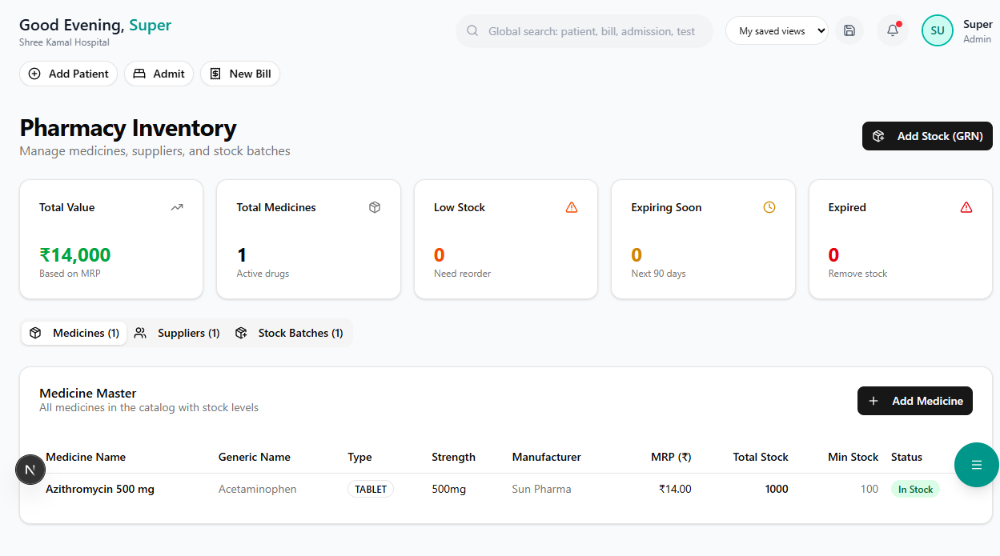

# Inventory Management

Track medicine stock, manage purchases, monitor expiry dates, and control inventory.

**Route:** `/dashboard/pharmacy/inventory`

**Sidebar:** Pharmacy → Inventory

---

## Stock Overview

| Column | Description |
|--------|-------------|
| **Medicine** | Name and generic name |
| **Category** | Tablet / Capsule / Injection / Syrup / etc. |
| **In Stock** | Current available quantity |
| **Batch** | Batch number |
| **Expiry** | Expiry date (red if within 90 days) |
| **MRP** | Maximum retail price |
| **Reorder Level** | Minimum stock threshold |

---

## Key Features

### Low Stock Alerts

Medicines falling below the **reorder level** are flagged with a red alert. The dashboard shows:
- Total items below reorder level
- Critical items (stock = 0)

### Expiry Tracking

| Alert | Timeframe |
|-------|-----------|
| **Red** | Expiring within 30 days |
| **Amber** | Expiring within 60 days |
| **Yellow** | Expiring within 90 days |

> **Tip:** Review expiry alerts weekly. Expired medicines must be removed from stock and returned to suppliers.

### Purchase Orders

1. Click **"New Purchase Order"**
2. Select the supplier
3. Add medicines with quantity and rate
4. Submit the PO
5. Record GRN (Goods Received Note) when stock arrives

### Stock Adjustments

Record non-sale stock movements:
- **Damage** — Broken or damaged items
- **Return** — Supplier returns
- **Transfer** — Inter-department transfers
- **Write-off** — Expired stock disposal
