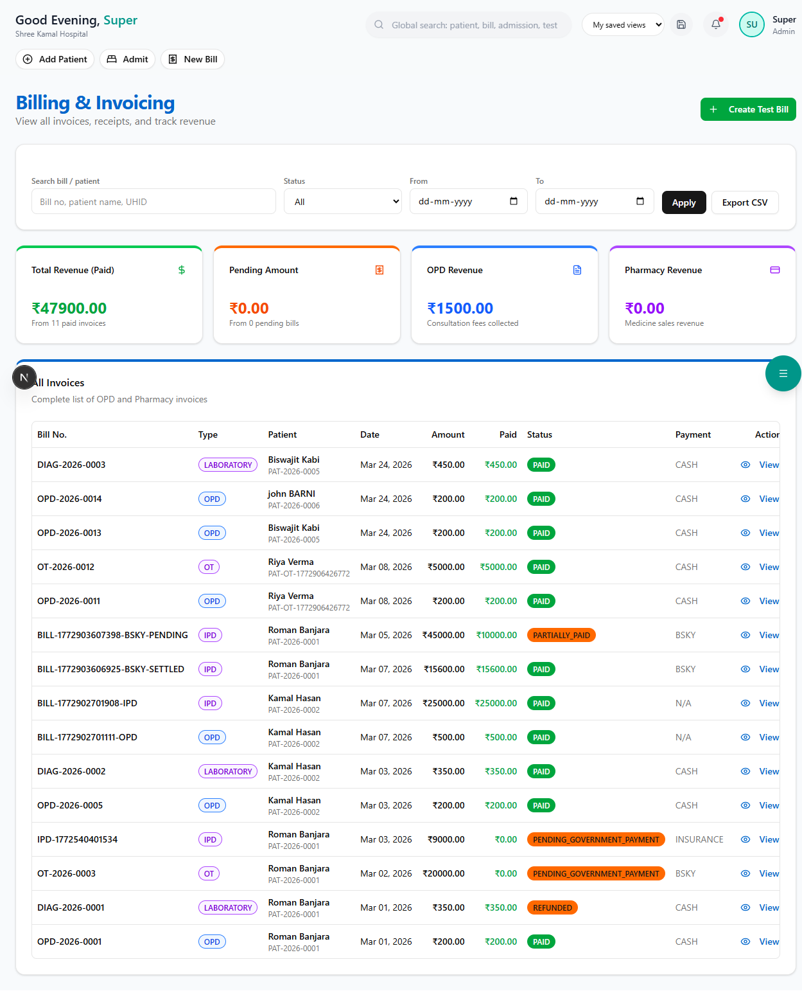

# Billing

Generate GST-compliant invoices for all hospital services — OPD, IPD, diagnostics, and pharmacy.

**Route:** `/dashboard/finance/billing`

**Sidebar:** Finance → Billing

---

## Billing Types

| Type | When |
|------|------|
| **OPD Bill** | Consultation fees, minor procedures |
| **IPD Bill** | Final bill at discharge (all-inclusive) |
| **Diagnostic Bill** | Lab tests and radiology charges |
| **Pharmacy Bill** | Medicine purchases (via POS) |

---

## Creating an IPD Bill

### Step 1 — Select Patient

Search for the admitted patient. The system loads all charges accumulated during the stay.

### Step 2 — Review Line Items

| Category | Examples |
|----------|----------|
| Room Rent | General Ward x 5 days = Rs.7,500 |
| ICU Charges | ICU x 2 days = Rs.20,000 |
| Doctor Fees | Consultation + Rounds = Rs.5,000 |
| Surgery | Appendectomy = Rs.45,000 |
| Investigation | CBC + CT Scan = Rs.3,300 |
| Pharmacy | Medicines during stay = Rs.4,200 |
| Nursing | Nursing charges = Rs.2,000 |
| Other | Miscellaneous = Rs.1,000 |

### Step 3 — Apply Discounts & Insurance

| Field | Description |
|-------|-------------|
| Discount | Bill-level or item-level discount |
| Insurance Adjustment | Amount covered by insurance (from approved claim) |
| Patient Payable | Net amount patient needs to pay |

### Step 4 — Collect Payment

Accept payment via:
- Cash, Card, UPI, Bank Transfer
- Insurance (auto-deducted from claim)
- Split payment (part cash, part insurance)

### Step 5 — Generate Invoice

The system generates a **GST-compliant invoice** with:
- Hospital header and GSTIN
- Patient details
- Itemized charges with HSN/SAC codes
- GST breakdown (CGST + SGST)
- Payment method and reference
- Printable A4 format with letterhead

> **Important:** All invoices are auto-numbered and stored permanently for audit purposes.
