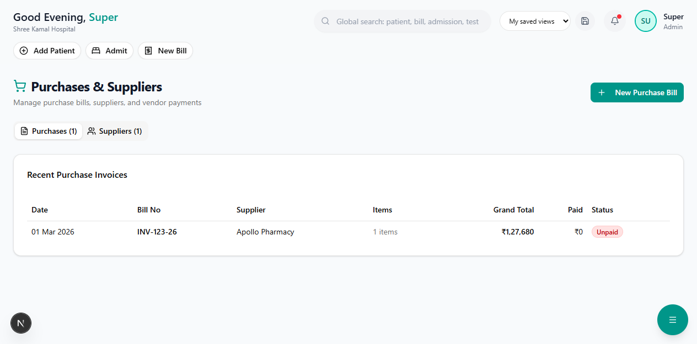

# Purchases & Suppliers

Manage purchase orders, track supplier payments, and record goods received.

**Route:** `/dashboard/finance/purchases`

**Sidebar:** Finance → Purchases

---

## Purchase Orders

### Creating a Purchase Order

1. Click **"New Purchase Order"**
2. Select the **Supplier** from the directory
3. Add items with:

| Field | Description |
|-------|-------------|
| Item | Medicine or supply name |
| Quantity | Number of units |
| Unit Price | Price per unit |
| GST % | Applicable GST rate |
| Total | Auto-calculated |

4. Review the PO total with GST
5. Submit or save as draft

---

## Supplier Directory

Maintain a list of all suppliers:

| Field | Description |
|-------|-------------|
| Supplier Name | Company name |
| Contact Person | Primary contact |
| Phone / Email | Contact details |
| GSTIN | Supplier's GST number |
| Payment Terms | Net 30 / Net 60 / COD |
| Bank Details | For online payments |

---

## Goods Received Note (GRN)

When stock arrives, record the GRN:
1. Select the Purchase Order
2. Verify received quantities against ordered
3. Enter batch numbers and expiry dates
4. Confirm receipt — stock is updated automatically
