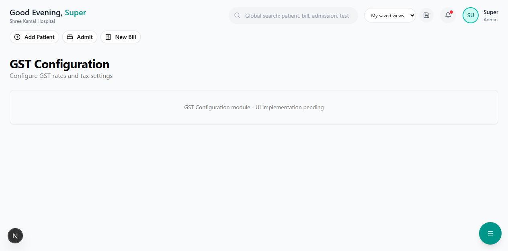

# GST & Tax Reports

Generate GST-compliant tax reports for filing returns.

**Route:** `/dashboard/finance/taxes`

**Sidebar:** Finance → Taxes

---

## Available Reports

### GSTR-1 (Outward Supplies)

Details of all sales and outward supplies:

| Field | Description |
|-------|-------------|
| Invoice Number | Auto-generated invoice number |
| Invoice Date | Date of the invoice |
| Customer GSTIN | Patient/company GSTIN (if applicable) |
| Taxable Value | Amount before GST |
| CGST | Central GST amount |
| SGST | State GST amount |
| IGST | Integrated GST (for inter-state) |
| Total | Invoice total |

### GSTR-3B (Summary Return)

Monthly summary of:
- Total outward supplies (taxable)
- Total inward supplies (with ITC)
- Net tax payable
- Tax already paid

### HSN Summary

Grouped by HSN/SAC code:

| HSN/SAC | Description | Taxable Value | GST Rate | Tax Amount |
|---------|-------------|---------------|----------|------------|
| 3004 | Medicaments | Rs.X | 12% | Rs.Y |
| 9993 | Healthcare services | Rs.X | Exempt | Rs.0 |

> **Note:** Healthcare services are **GST-exempt** in India. GST applies primarily to pharmacy sales and certain premium services.

---

## Report Features

| Feature | Description |
|---------|-------------|
| **Date Range** | Filter by custom date range |
| **PDF Export** | Download as PDF for records |
| **Excel Export** | Download as Excel for further analysis |
| **Monthly View** | Default monthly breakdown |

---

## Day Book

**Route:** `/dashboard/reports/day-book`

Daily transaction summary showing:
- All receipts (collections)
- All payments (expenses)
- Opening and closing balance
- Payment method breakdown (Cash / Card / UPI / Insurance)
