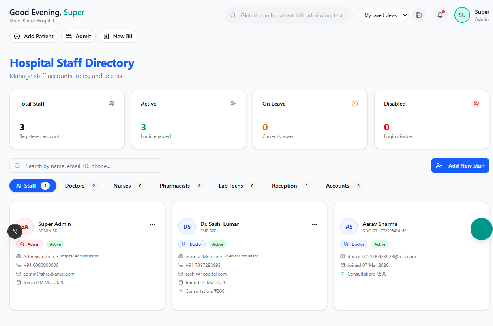
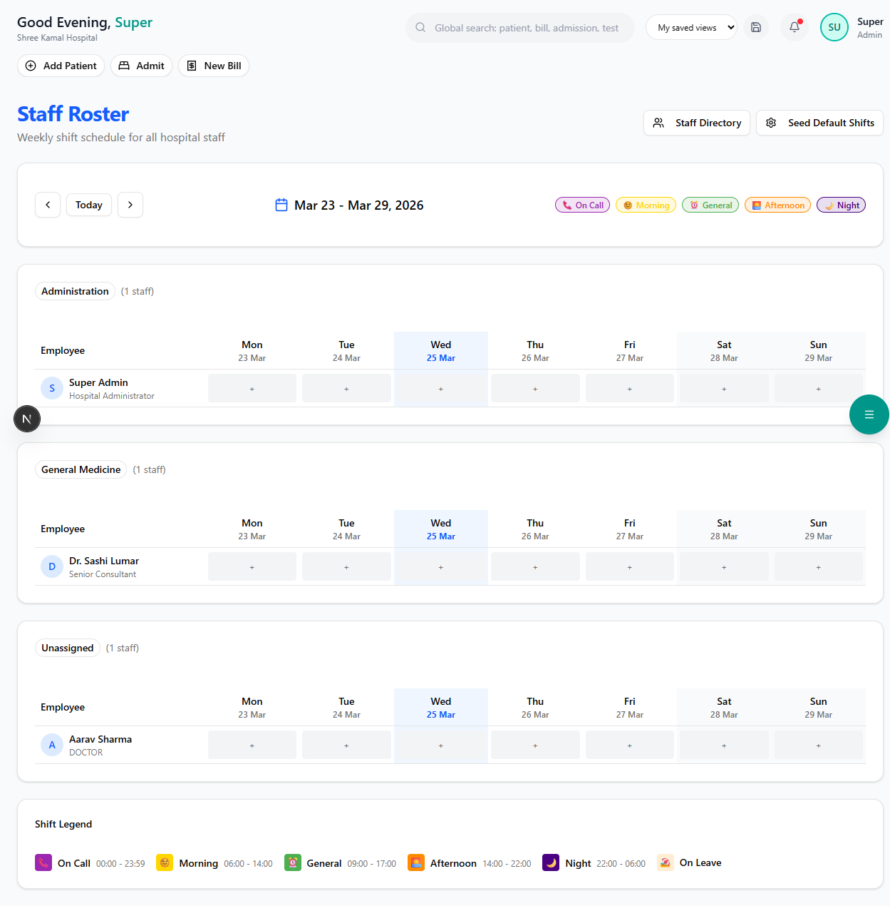

# Staff Management

Manage all hospital employees — doctors, nurses, technicians, and administrative staff.

**Route:** `/dashboard/hr/staff`

**Sidebar:** HR → Staff Management

---

## Staff Directory

The staff directory shows all employees with quick filters:

| Filter | Options |
|--------|---------|
| **Department** | Medicine, Surgery, Nursing, Lab, Radiology, Pharmacy, Admin |
| **Designation** | Doctor, Nurse, Technician, Receptionist, Accountant |
| **Status** | Active / On Leave / Inactive |

### Staff Table Columns

| Column | Description |
|--------|-------------|
| Name | Full name with photo |
| Employee ID | Unique staff identifier |
| Department | Assigned department |
| Designation | Job title |
| Phone | Contact number |
| Status | Active / On Leave / Inactive |
| Actions | View / Edit / Deactivate |

---

## Adding New Staff

**Route:** `/dashboard/hr/staff/add`

### Step 1 — Personal Information

| Field | Required | Description |
|-------|----------|-------------|
| Full Name | Yes | As per official ID |
| Date of Birth | Yes | For age calculation |
| Gender | Yes | Male / Female / Other |
| Phone | Yes | Primary contact |
| Email | No | For login credentials |
| Address | Yes | Current residential address |
| Aadhaar Number | Yes | 12-digit Aadhaar for verification |
| PAN | No | For salary/TDS purposes |

### Step 2 — Professional Details

| Field | Required | Description |
|-------|----------|-------------|
| Department | Yes | Select from department list |
| Designation | Yes | Job title / role |
| Qualification | Yes | Highest degree (MBBS, MD, BSc Nursing, etc.) |
| Registration No. | Conditional | Medical Council registration (for doctors) |
| Specialization | Conditional | For doctors only |
| Date of Joining | Yes | Employment start date |
| Employment Type | Yes | Permanent / Contract / Visiting |

### Step 3 — Salary & Bank Details

| Field | Required | Description |
|-------|----------|-------------|
| Basic Salary | Yes | Monthly basic pay |
| Bank Name | Yes | Salary account bank |
| Account Number | Yes | Bank account number |
| IFSC Code | Yes | Bank branch IFSC |
| PF Number | No | Provident Fund account |
| ESI Number | No | Employee State Insurance |

Click **"Save Staff"** to create the employee record.

---

## Duty Roster

**Route:** `/dashboard/hr/roster`

### Creating a Roster

1. Select **Department** and **Month**
2. The system shows a calendar grid with all staff in that department
3. For each staff member, assign shifts:

| Shift | Time | Color |
|-------|------|-------|
| **Morning** | 6:00 AM – 2:00 PM | Blue |
| **Afternoon** | 2:00 PM – 10:00 PM | Orange |
| **Night** | 10:00 PM – 6:00 AM | Purple |
| **Off** | Day off | Gray |
| **Leave** | Approved leave | Red |

4. Click on a cell to toggle shift assignment
5. Click **"Save Roster"** to finalize

> **Tip:** The system prevents assigning back-to-back Night → Morning shifts to comply with labor regulations.

---

## Leave Management

**Route:** `/dashboard/hr/leave`

### Applying for Leave

1. Staff submits leave request with:
   - Leave type (Casual / Sick / Earned / Maternity / Paternity)
   - From date and To date
   - Reason
2. Department head receives notification
3. Approves or rejects the request

### Leave Balance

| Leave Type | Annual Entitlement |
|------------|-------------------|
| Casual Leave | 12 days |
| Sick Leave | 12 days |
| Earned Leave | 15 days (carry forward allowed) |
| Maternity | 26 weeks |
| Paternity | 15 days |

> **Note:** Leave entitlements can be customized in **Admin → Hospital Settings**.
