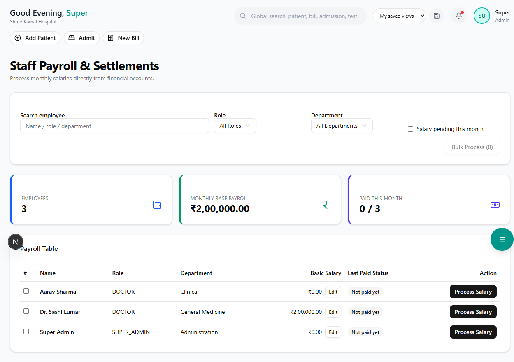

# Payroll

Process monthly salaries, generate payslips, and manage statutory deductions.

**Route:** `/dashboard/hr/payroll`

**Sidebar:** HR → Payroll

---

## Salary Structure

Each employee's salary is composed of:

| Component | Type | Description |
|-----------|------|-------------|
| **Basic Salary** | Earning | Base pay as per appointment |
| **HRA** | Earning | House Rent Allowance (usually 40-50% of basic) |
| **DA** | Earning | Dearness Allowance |
| **Special Allowance** | Earning | Any additional allowance |
| **PF (Employee)** | Deduction | 12% of basic (employee contribution) |
| **PF (Employer)** | Deduction | 12% of basic (employer contribution) |
| **ESI** | Deduction | 0.75% employee + 3.25% employer (if salary < 21,000) |
| **Professional Tax** | Deduction | As per state rules |
| **TDS** | Deduction | Income tax deducted at source |

---

## Monthly Payroll Processing

**Route:** `/dashboard/hr/payroll/process`

### Step 1 — Select Month & Year

Choose the payroll month (e.g., March 2026).

### Step 2 — Review Attendance

The system auto-pulls:
- Total working days in the month
- Days present (from duty roster)
- Leave days (from leave management)
- Loss of Pay (LOP) days

| Attendance Status | Impact |
|-------------------|--------|
| Present | Full day salary |
| Half Day | 50% of daily rate |
| Leave (Paid) | Full day salary |
| Leave (Unpaid / LOP) | Deducted from gross |
| Absent | Deducted from gross |

### Step 3 — Calculate Salary

Click **"Calculate All"** to compute:
- Gross earnings (Basic + HRA + DA + Allowances)
- Total deductions (PF + ESI + PT + TDS + LOP)
- **Net Salary = Gross Earnings - Total Deductions**

### Step 4 — Review & Approve

| Column | Description |
|--------|-------------|
| Employee | Name and ID |
| Gross | Total earnings |
| Deductions | Total deductions |
| Net Pay | Amount to be credited |
| Status | Pending / Approved / Paid |

Review each entry. Click **"Approve Payroll"** to finalize.

### Step 5 — Process Payment

After approval:
- Generate bank transfer file (for bulk NEFT/RTGS)
- Or mark individual payments as completed
- System records payment date and transaction reference

---

## Payslips

**Route:** `/dashboard/hr/payroll/payslips`

### Generating Payslips

1. Select month and year
2. Click **"Generate Payslips"**
3. System creates individual payslips for all processed employees

### Payslip Contents

| Section | Details |
|---------|---------|
| **Header** | Hospital name, logo, payslip month |
| **Employee Info** | Name, ID, department, designation, bank account |
| **Earnings** | Basic, HRA, DA, Special Allowance — with amounts |
| **Deductions** | PF, ESI, PT, TDS, LOP — with amounts |
| **Summary** | Gross Pay, Total Deductions, **Net Pay** |
| **Footer** | "This is a computer-generated payslip" |

Payslips can be:
- **Printed** for physical distribution
- **Downloaded as PDF**
- **Emailed** to staff (if email configured)

---

## Statutory Reports

| Report | Purpose | Frequency |
|--------|---------|-----------|
| **PF Return** | EPF contribution details | Monthly |
| **ESI Return** | ESI contribution details | Monthly |
| **Form 16** | TDS certificate for employees | Annual |
| **Professional Tax** | State-wise PT challan | Monthly |
| **Salary Register** | Complete salary record | Monthly |

> **Important:** Ensure PF and ESI returns are filed before the 15th of each month to avoid penalties.
