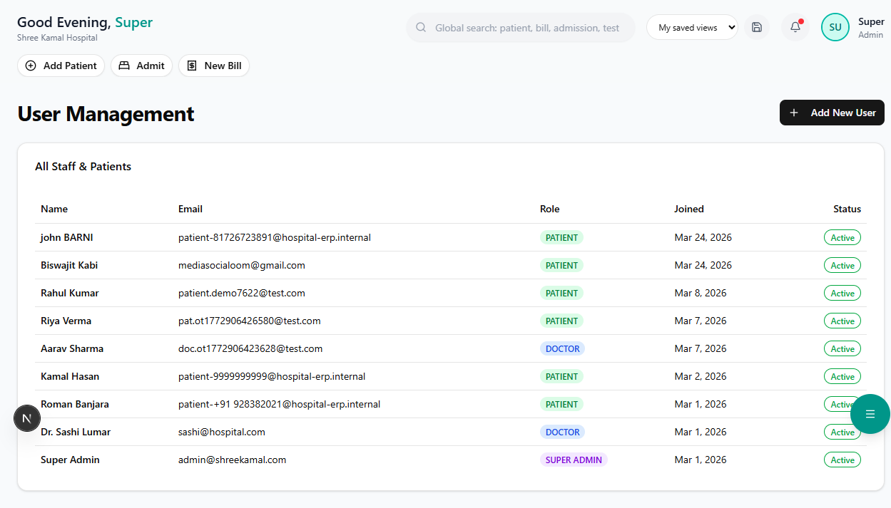

# User Management

Control who can access the system and what they can do.

**Route:** `/dashboard/settings/users`

**Sidebar:** Settings → User Management

---

## User List

The user list shows all registered accounts:

| Column | Description |
|--------|-------------|
| Name | User's full name |
| Email | Login email address |
| Role | Assigned role (Admin, Doctor, Nurse, etc.) |
| Department | Associated department |
| Status | Active / Inactive / Locked |
| Last Login | Most recent login timestamp |
| Actions | Edit / Deactivate / Reset Password |

---

## Creating a New User

**Route:** `/dashboard/settings/users/add`

### Required Information

| Field | Description |
|-------|-------------|
| Full Name | User's display name |
| Email | Login email (must be unique) |
| Phone | Contact number |
| Role | Select from predefined roles |
| Department | Assign to a department |
| Password | Temporary password (user changes on first login) |

Click **"Create User"** to save. The user receives login credentials.

> **Important:** Always use strong passwords. The system enforces minimum 8 characters with at least one uppercase, one lowercase, and one number.

---

## Roles & Permissions

### Predefined Roles

| Role | Access Level |
|------|-------------|
| **Super Admin** | Full access to all modules, settings, and user management |
| **Admin** | All modules except system-level settings |
| **Doctor** | OPD, IPD, EMR, Lab orders, Prescriptions |
| **Nurse** | IPD, Vital signs, Medication administration, Duty roster |
| **Receptionist** | Patient registration, Appointments, Billing |
| **Pharmacist** | Pharmacy POS, Inventory, Purchase orders |
| **Lab Technician** | Lab queue, Result entry, Report generation |
| **Radiologist** | Radiology queue, Reports, Image uploads |
| **Accountant** | Billing, Finance, Purchases, GST reports |
| **Insurance Desk** | Insurance verification, Pre-auth, Claims |

### Permission Matrix

Each role has granular permissions:

| Permission | Description |
|------------|-------------|
| **View** | Can see the module/page |
| **Create** | Can add new records |
| **Edit** | Can modify existing records |
| **Delete** | Can remove records (soft delete) |
| **Approve** | Can approve workflows (e.g., pre-auth, purchase orders) |
| **Export** | Can download/export data |
| **Print** | Can print reports and documents |

### Custom Roles

To create a custom role:

1. Go to **Settings → Roles**
2. Click **"Create New Role"**
3. Enter role name and description
4. Toggle permissions for each module:
   - Patient Management (View / Create / Edit)
   - OPD (View / Create / Edit)
   - IPD (View / Create / Edit / Discharge)
   - Pharmacy (View / Dispense / Manage Inventory)
   - Lab (View / Enter Results / Verify)
   - Billing (View / Create / Void / Refund)
   - Insurance (View / Verify / Pre-Auth / Claims)
   - Finance (View / Approve / Export)
   - HR (View / Manage Staff / Payroll)
   - Settings (View / Edit)
5. Click **"Save Role"**

---

## Security Features

| Feature | Description |
|---------|-------------|
| **Session Timeout** | Auto-logout after 30 minutes of inactivity |
| **Login Attempts** | Account locked after 5 failed attempts |
| **Password Policy** | Minimum 8 chars, mixed case, numbers required |
| **Audit Trail** | All actions logged with user, timestamp, and IP |
| **Two-Factor Auth** | Optional OTP verification for admin accounts |

---

## Audit Log

**Route:** `/dashboard/settings/audit`

Track all user actions in the system:

| Column | Description |
|--------|-------------|
| Timestamp | Date and time of action |
| User | Who performed the action |
| Action | What was done (Create / Update / Delete / Login / Export) |
| Module | Which module was affected |
| Details | Specific record or field changed |
| IP Address | User's IP address |

> **Tip:** Use the audit log to investigate discrepancies in billing, inventory, or patient records.
