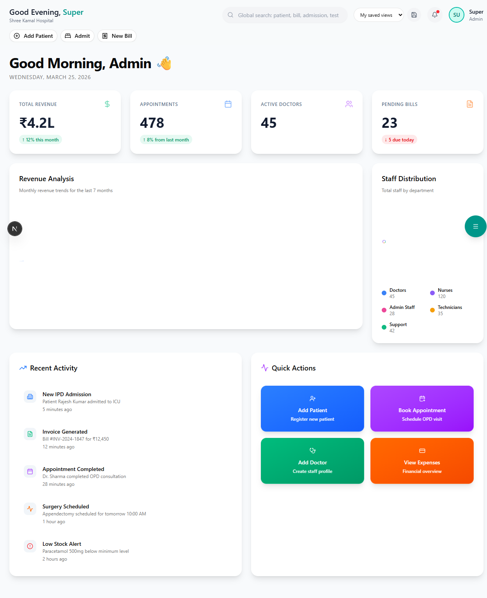

# Hospital Settings

Configure your hospital's profile, departments, and system-wide preferences.

**Route:** `/dashboard/settings`

**Sidebar:** Settings → Hospital Settings

---

## Hospital Profile

**Route:** `/dashboard/settings/hospital`

### Basic Information

| Field | Description |
|-------|-------------|
| Hospital Name | Official registered name |
| Logo | Upload hospital logo (used in reports, bills, letterheads) |
| Address | Full address with PIN code |
| Phone | Main reception number |
| Email | Official email address |
| Website | Hospital website URL |

### Registration Details

| Field | Description |
|-------|-------------|
| **ROHINI ID** | Required for PMJAY/BSKY empanelment. Obtained from NHA portal |
| **NIN (NHA ID)** | National Health Authority identifier |
| **State Health Agency ID** | For state-specific schemes (e.g., BSKY in Odisha) |
| GSTIN | GST registration number (for billing compliance) |
| PAN | Hospital's PAN for TDS/financial records |
| Registration Number | State medical council registration |
| Accreditation | NABH / NABL accreditation details |

> **Important:** ROHINI ID is mandatory for processing any government insurance claims (PMJAY, BSKY). Apply at [rohini.nha.gov.in](https://rohini.nha.gov.in) if not yet registered.

---

## Department Configuration

**Route:** `/dashboard/settings/departments`

### Adding a Department

1. Click **"Add Department"**
2. Fill in:

| Field | Description |
|-------|-------------|
| Department Name | e.g., General Medicine, Orthopedics, Pediatrics |
| Department Code | Short code (e.g., MED, ORTHO, PED) |
| HOD | Head of Department (select from doctor list) |
| Location | Building / Floor / Wing |
| Status | Active / Inactive |

3. Click **"Save"**

### Default Departments

The system comes pre-configured with:

| Department | Code |
|------------|------|
| General Medicine | MED |
| General Surgery | SURG |
| Orthopedics | ORTHO |
| Pediatrics | PED |
| Obstetrics & Gynecology | OBGY |
| ENT | ENT |
| Ophthalmology | EYE |
| Dermatology | DERM |
| Cardiology | CARD |
| Emergency | ER |
| ICU | ICU |

---

## Bed & Ward Configuration

**Route:** `/dashboard/settings/beds`

### Ward Setup

| Field | Description |
|-------|-------------|
| Ward Name | e.g., Male General, Female General, Pediatric |
| Ward Type | General / Semi-Private / Private / ICU / NICU / Isolation |
| Floor | Building floor number |
| Total Beds | Number of beds in the ward |
| Rate per Day | Room rent charges |

### Bed Management

Each bed has:
- **Bed Number** — Unique identifier (e.g., MG-101)
- **Status** — Available / Occupied / Under Maintenance / Reserved
- **Linked Patient** — If occupied, shows current patient

> **Tip:** Room rent rates are critical for insurance. Ensure they match your TPA-agreed tariff to avoid claim deductions.

---

## Billing Configuration

**Route:** `/dashboard/settings/billing`

| Setting | Description |
|---------|-------------|
| **Currency** | INR (Indian Rupees) |
| **GST Rate** | Default GST % for services (typically 5% for healthcare) |
| **Medicine GST** | GST on pharmacy sales (5% / 12% / 18% based on category) |
| **Bill Prefix** | Custom prefix for bill numbers (e.g., HOSP-2026-) |
| **Auto-numbering** | Sequential bill number generation |
| **Payment Modes** | Enable/disable Cash, Card, UPI, Insurance, Credit |
| **Receipt Template** | Choose thermal (58mm/80mm) or A4 format |

---

## Insurance Configuration

**Route:** `/dashboard/settings/insurance`

### TPA Configuration

Add Third Party Administrators:

| Field | Description |
|-------|-------------|
| TPA Name | e.g., Medi Assist, MD India, Paramount |
| TPA Code | Unique identifier |
| Contact Person | Name of relationship manager |
| Phone | TPA helpdesk number |
| Email | Claims submission email |
| Portal URL | TPA web portal link |

### Scheme Configuration

| Scheme | Configuration |
|--------|--------------|
| **PMJAY** | ROHINI ID, NHA credentials, package rates |
| **BSKY** | SHA ID, state portal credentials, package rates |
| **Private Insurance** | TPA list, tariff agreements, room category caps |

### Tariff Master

Upload or configure hospital tariff rates that are agreed upon with TPAs:
- Procedure rates
- Room rent categories and caps
- Package rates for common surgeries
- Investigation charges

---

## System Preferences

**Route:** `/dashboard/settings/preferences`

| Preference | Options | Default |
|------------|---------|---------|
| Date Format | DD/MM/YYYY or MM/DD/YYYY | DD/MM/YYYY |
| Time Format | 12-hour or 24-hour | 12-hour |
| Language | English / Hindi / Odia | English |
| Session Timeout | 15 / 30 / 60 minutes | 30 minutes |
| Auto-backup | Daily / Weekly / Disabled | Daily |
| Email Notifications | Enable / Disable | Enabled |
| SMS Notifications | Enable / Disable | Disabled |

---

## Backup & Data

| Action | Description |
|--------|-------------|
| **Export Data** | Download patient, billing, or inventory data as CSV/Excel |
| **Database Backup** | Manual backup trigger (in addition to auto-backup) |
| **Restore** | Restore from a previous backup point |

> **Warning:** Database restore will overwrite current data. Always create a fresh backup before restoring.
